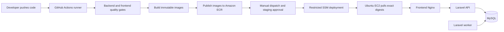
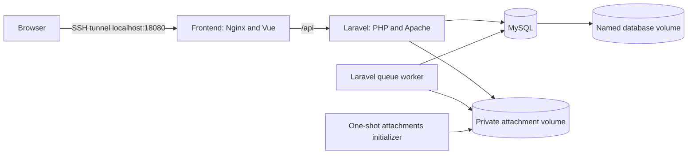

# CampusDesk CI/CD and Operations Status

**Last reviewed:** 25 November 2026

This file is the entry point for the CampusDesk CI/CD work. Detailed implementation records live under `Docs/`.

The active remediation plan is the [CI/CD Hardening Plan](Docs/CI_CD_HARDENING_PLAN.md): it records the five defects found during the November 2026 staging investigation (ancestor-only release validation, duplicated build recipes, no build-once promotion, the hardcoded Reverb key, and release observability) and the phased, testable plan to fix them.

Phase 1's release-selection design — release manifests, normal/idempotent/rollback rules, the IAM split, and the PR sequence — is in [Docs/CI_CD_PHASE_1_DESIGN.md](Docs/CI_CD_PHASE_1_DESIGN.md).

Phase 2's one-build-recipe design is in [Docs/CI_CD_PHASE_2_DESIGN.md](Docs/CI_CD_PHASE_2_DESIGN.md). Both the PR validation path and the development publication path call the same reusable workflow, [build-images.yml](.github/workflows/build-images.yml).

Phase 3's reproducible-build design is in [Docs/CI_CD_PHASE_3_DESIGN.md](Docs/CI_CD_PHASE_3_DESIGN.md). Base images are pinned by digest, release images carry provenance and SBOM, and a separate dispatch verifies application-file reproducibility.

Phase 4's runtime Reverb design is in [Docs/CI_CD_PHASE_4_DESIGN.md](Docs/CI_CD_PHASE_4_DESIGN.md). The frontend image is key-free; an Nginx entrypoint writes `/config.js` from the container environment. Key rotation recreates the containers without rebuilding the image.

Phase 5's end-to-end release verification design is in [Docs/CI_CD_PHASE_5_DESIGN.md](Docs/CI_CD_PHASE_5_DESIGN.md). The backend bakes its build SHA and commit timestamp; `/api/version`, the SPA meta, and `config.js` expose the same identity; the host verifies them before recording the deployment. A separate Trivy job scans the published images before the release manifest.

## Image publication model

Pull-request runs build both images only to validate the Dockerfiles; those images are never published. A push to `development`, including a merged pull request, runs the publish jobs, which build and push the release images tagged with the pushed commit SHA. Release images are built from digest-pinned bases and carry build provenance (with build arguments and materials) and an SBOM. Deployment resolves those tags to immutable digests. The hardening plan records why this model is being tightened.

### Model A: build once per development commit

- The release identity is the `development` commit SHA.
- A pull request build validates the recipe and never publishes.
- A `development` push builds that commit once, publishes the images with provenance and SBOM, and writes the release manifest.
- Deployments consume the manifest and pull the recorded digests; they never rebuild.
- A PR merge ref and its merge commit are different SHAs by design; the recipe is identical.

### Runtime Reverb configuration

The frontend image contains no Reverb key. The Nginx entrypoint writes `/usr/share/nginx/html/config.js` from the container's `REVERB_APP_KEY`; `index.html` loads it before the app bundle, and `config.js` is served with `Cache-Control: no-store`. The host `/opt/campusdesk/.env.staging` is the single source for the frontend, backend, Reverb, and workers. Rotating the key requires recreating those containers, not rebuilding the image.

### Release verification and scan

The backend image bakes `APP_BUILD_SHA` and the commit-timestamp `APP_BUILD_TIME`; `GET /api/version` returns both. The frontend bakes its build SHA into `meta[name="app-build"]` and `config.js` (`buildSha`). The host deploy script compares all three with `RELEASE_SHA` and writes the verified identity to `release.json`. The deployment summary uses only verified step and host outputs. A separate Trivy job gates the release manifest on CRITICAL/HIGH findings (PR B).

Deployments now require a published release manifest. A normal deployment must use the current `development` tip and the latest published release; re-deploying the current release is idempotent; a rollback requires `allow_previous_release` plus a reason and a target older than the deployed release. The operator procedure is in the handoff guide.

## Current status

- [x] Repair and verify existing backend and frontend quality gates.
- [x] Dockerize the Laravel backend.
- [x] Dockerize the Vue frontend with an Nginx runtime.
- [x] Run MySQL, Laravel, the queue worker, and the frontend with Docker Compose.
- [x] Verify health checks, queue execution, private attachment persistence, database persistence, and same-origin API proxying.
- [x] Establish the GitHub Actions execution model for quality gates, image publication, and controlled deployment.
- [x] Add continuous integration for backend and frontend checks.
- [x] Build images in CI after the quality gates pass.
- [x] Publish commit-SHA-tagged images to immutable Amazon ECR repositories through GitHub OIDC.
- [x] Deploy digest-pinned images to an Ubuntu 24.04 AMD64 EC2 instance.
- [x] Run migrations and the full demonstration seed explicitly.
- [x] Create and verify student and Super Admin access.
- [x] Restrict the staging frontend to EC2 loopback and access it through an SSH tunnel.
- [x] Add a protected, manually approved deployment workflow using GitHub OIDC and a restricted SSM document.
- [x] Verify deployment locking, exact digest resolution, migration execution, health checks, and the idempotent no-op path.
- [x] Initialize the private attachment volume before application startup and reject failed storage writes without persisting corrupt records.
- [x] Functionally verify the full request lifecycle and authenticated attachment upload/download in staging.
- [x] Provision encrypted, versioned off-host recovery storage and least-privilege runtime access.
- [x] Automate twice-daily coherent database/attachment recovery capture with upload/download verification.
- [x] Complete an isolated database, attachment, and captured-backend-image restore test.
- [x] Enable 15-minute freshness monitoring and verify the missing-heartbeat CloudWatch alarm returns to `OK`.
- [x] Verify the first unattended systemd timer-triggered backup cycle.
- [x] Deploy permanent account disablement and remediate every staging account still matching the known demonstration password.
- [x] Verify retained-role access, a zero-result follow-up scan, application health, and a post-remediation off-site capture and isolated restore.
- [ ] Add DNS and HTTPS before controlled public staging access.

## Comprehensive implementation and operations guide

Read the consolidated [CI/CD Comprehensive Implementation and Operations Guide](Docs/CI_CD_SESSION_2_HANDOFF.md) for:

- the verified local Docker architecture, files, service boundaries, and operating commands;
- local environment, networking, persistence, queue, upload-limit, health-check, and shutdown behavior;
- local and staging verification evidence and troubleshooting history;
- the current GitHub Actions workflow and event behavior;
- GitHub OIDC, least-privilege IAM, and ECR configuration;
- the EC2 architecture and security boundary;
- digest-pinned Compose deployment and operating commands;
- the protected GitHub `staging` environment, dedicated deployment role, restricted SSM document, and fixed host script;
- migrations, one-time seeding, and manual Super Admin creation;
- attachment-volume initialization, storage failure handling, authorization hardening, and staging verification;
- every significant deployment failure and its resolution; and
- recovery infrastructure, scheduled capture, isolated restore, freshness monitoring, and first unattended-cycle evidence;
- current limitations and prioritized continuation work.

## End-to-end direction

## Current staging architecture

## Next operational milestone

The controlled deployment, credential remediation, and recovery workflows are implemented and verified. The next milestone is public-access readiness and continued operational assurance:

1. keep deployed image digests, backup IDs, and restore evidence in the approved operational record;
2. continue periodic isolated restore drills and investigate every backup/monitor service failure;
3. repeat credential remediation after any future full demonstration seed or pre-remediation restore;
4. evaluate Systems Manager Session Manager so interactive SSH can eventually be removed; and
5. add stable DNS and HTTPS before controlled public access.

Pushes to `development` publish immutable images automatically. EC2 deployment remains deliberately manual-triggered and approval-gated, and the application remains private behind an SSH tunnel. Repository changes to `compose.staging.yaml` or the fixed host deployment script require a separate reviewed host update.
