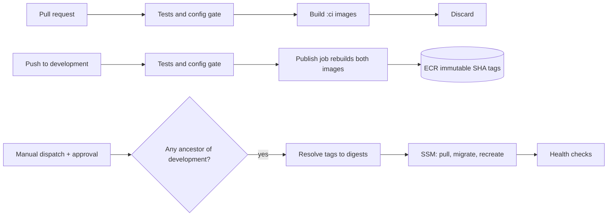
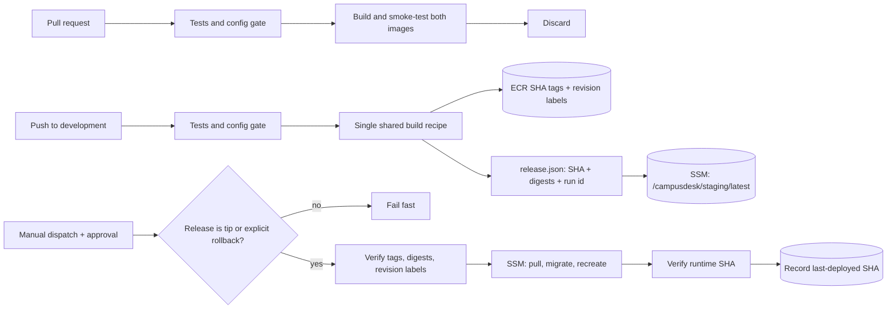

# CampusDesk — CI/CD Hardening Plan

**Last reviewed:** 25 November 2026

**Status:** ✅ Phase 0 closed on staging (20 November 2026). ✅ Phase 1 verified on staging (21 November 2026). ✅ Phase 2 verified in CI and on staging (23 November 2026). ✅ Phase 3 verified in CI and on staging (24 November 2026). ✅ Phase 4 verified on staging (25 November 2026). Phase 5 PR A is verified on staging (25 November 2026); PR B is implemented on `ci/release-scan`; scan/manifest verification, the negative mismatch test, and the runbooks are pending. Delete the unused `VITE_REVERB_APP_KEY` repository variable.

**Scope:** [.github/workflows/ci.yml](../.github/workflows/ci.yml), [.github/workflows/deploy-staging.yml](../.github/workflows/deploy-staging.yml), [Frontend/Dockerfile](../Frontend/Dockerfile), [campusdesk/Dockerfile](../campusdesk/Dockerfile), [compose.yaml](../compose.yaml), [compose.staging.yaml](../compose.staging.yaml), the host deployment script, and the related documentation.

**Related:** [CI-CD.md](../CI-CD.md) (entry point), [CI/CD implementation and operations guide](CI_CD_SESSION_2_HANDOFF.md), [KNOWN_ISSUES.md](KNOWN_ISSUES.md), [STAGING_RECOVERY.md](STAGING_RECOVERY.md).

This document records five defects found while investigating the 18 November 2026 staging "missing changes" report, explains why each exists and what it can break, and defines a phased, testable plan. Checkboxes are ticked only for work implemented on the branch named below; acceptance tests are ticked only after they pass against staging.

## Status

| Phase | State |
| --- | --- |
| 0 — Instrument and guard | ✅ Closed 20 November 2026; staging acceptance verified, two environment-only checks documented |
| 1 — Release selection guard | ✅ Verified 21 November 2026; five acceptance checks documented as not exercised |
| 2 — One build recipe | ✅ Verified 23 November 2026; three checks documented as not exercised |
| 3 — Reproducible release builds | ✅ Verified 24 November 2026; existing-tag check documented as not exercised |
| 4 — Runtime configuration | ✅ Verified 25 November 2026; repository-variable cleanup pending |
| 5 — End-to-end release verification | 🚧 PR B implemented; scan/manifest + runbooks pending |

---

## 1. Why this plan exists

### 1.1 The incident that triggered it

On 18 November 2026 the operator deployed the `development` tip `79bbf0b` to staging and reported that "a couple of changes" from the theme/notification work were not visible in staging, although the same code was visible locally. The working hypothesis was that a stale or wrong image had been deployed.

### 1.2 What the investigation proved

The staging artefact was correct at every link in the chain:

| Link | Verified evidence |
| --- | --- |
| Running frontend container | `Config.Image` = `…/campusdesk_frontend@sha256:76dcb2b8…` |
| ECR tag `79bbf0b` | resolves to `sha256:76dcb2b8…` (exact match) |
| Deploy action | SSM log shows a fresh digest pull and **Recreate** of `frontend`, `backend`, `worker`, `reverb` — not the no-op path |
| Image contents | the app layer downloaded from ECR contains `index.html` → `index-DGKx_E9Q.js` |
| Commit content in the image | `Mark all read`, `unread`, `badge-orange`, `badge-purple`, the `#main-content:focus` rules from `610f6fc`, and `StaffCaseWorkspace-DQyQwns2.css` |
| Runtime config | staging `REVERB_APP_KEY=campusdesk-key` matches the key baked into the image |

The missing changes were local: the Vite dev server had been serving a stale module graph. Restarting it brought local and staging into sync. This is the same class of staleness already recorded for Tailwind/PostCSS config changes in [KNOWN_ISSUES.md](KNOWN_ISSUES.md).

### 1.3 What the investigation exposed

The incident was **not** a pipeline failure, but four properties of the pipeline made it hard to prove that in less than several hours:

1. an old commit can be deployed as if it were a release;
2. the same image is built by two different recipes;
3. the artefact validated in CI is not the artefact that ships;
4. the pipeline cannot state, in one place, which commit is live.

The five defects in section 3 are the concrete causes of those properties.

---

## 2. Current pipeline (as-is)

### 2.1 Events and jobs

| Event | Quality gates | `backend-image` / `frontend-image` | `backend-publish` / `frontend-publish` |
| --- | --- | --- | --- |
| `pull_request` → `development` | run | run, tagged `:ci`, discarded with the runner | skipped |
| PR merged | — | — | separate `push` run: build jobs skipped, publish jobs rebuild and push |
| `push` → `development` | run | **skipped** (`if: github.event_name != 'push'`) | rebuild and push at the pushed tip |
| `workflow_dispatch` | run | run (throwaway) | skipped |

A merge is seen only as a push: `closed` is not a default `pull_request` activity type, and the publish condition requires `github.event_name == 'push'`.

### 2.2 Image paths

- **PR/validation:** `docker build` → local `campusdesk-{backend,frontend}:ci`, never pushed and never uploaded as an artefact.
- **Release:** `backend-publish` and `frontend-publish` each run their own `docker build` after an ECR existence check, then push `campusdesk_*:<full-sha>`.
- **Deploy:** `deploy-staging.yml` resolves `imageTag=<sha>` in both repositories to digests and passes digest-pinned references to SSM.

### 2.3 Deploy selection

The only release constraint is `git merge-base --is-ancestor "$RELEASE_SHA" HEAD` ([deploy-staging.yml:64](../.github/workflows/deploy-staging.yml#L64)), plus format and existence checks. There is no tip check, no downgrade check, no provenance check, and no ref assertion in the YAML.

### 2.4 Host-side gap

At the time of the investigation, `/usr/local/sbin/campusdesk-deploy` and the `CampusDesk-DeployStaging` SSM document were **not version-controlled in this repository**; their behaviour was known only from [CI_CD_SESSION_2_HANDOFF.md](CI_CD_SESSION_2_HANDOFF.md) (sections "Restricted SSM document" and "Fixed host deployment script"). Phase 0 now tracks both under [`ops/staging/`](../ops/staging/README.md), with the document held as a template and the account ID injected at registration. The host copies are still installed and registered manually.

### 2.5 As-is flow



---

## 3. Defect catalogue

Severity reflects impact if the defect fires, not how often it has fired.

### D1 — Ancestor-only release validation

**Where:** [deploy-staging.yml:47-69](../.github/workflows/deploy-staging.yml#L47-L69), especially line 64.

**What it is:** the deploy accepts any commit reachable from the checked-out `development` tip. It does not require the tip, the newest published release, a forward move, or a CI-produced image.

**Why it exists:** an ancestor check was the cheapest way to reject foreign SHAs. The error text ("not part of the selected development history") implies a stronger guarantee than the code provides.

**Failure modes:**

- silent stale deploy of any past tip — tags are immutable and never expire, so old releases remain deployable forever;
- deploying a post-merge feature commit such as `610f6fc`, `1a11dff`, or `85eed02` passes the git checks but has no image, so the failure surfaces late and with a misleading message;
- no downgrade protection: a rollback and a forward deploy use the same flow and approval;
- `HEAD` is whatever the dispatch was launched from, and the YAML never asserts `github.ref == 'refs/heads/development'`;
- no check that the tags came from a successful CI run for that SHA.

**Severity:** high impact, moderate likelihood. This is the only defect that can silently ship the wrong code.

**Phase 0 status:** the workflow now rejects any dispatch that is not from `refs/heads/development`; the ancestor check itself is unchanged until Phase 1.

### D2 — Duplicated build recipes

**Where:**

- backend: [ci.yml:114-125](../.github/workflows/ci.yml#L114-L125) vs [ci.yml:216-233](../.github/workflows/ci.yml#L216-L233);
- frontend: [ci.yml:141-154](../.github/workflows/ci.yml#L141-L154) vs [ci.yml:295-314](../.github/workflows/ci.yml#L295-L314);
- gating: `if: github.event_name != 'push'` at [ci.yml:102](../.github/workflows/ci.yml#L102) and [:129](../.github/workflows/ci.yml#L129); publish conditions at [:158](../.github/workflows/ci.yml#L158) and [:237](../.github/workflows/ci.yml#L237).

**What it is:** the same two images are built by two independent, hand-maintained command sequences that only one of may run per event.

**Why it exists:** PR build validation predates ECR publishing. When publishing was added, rebuilding in the publish job avoided a second build within one push run, but created a second recipe.

**Failure modes:**

- silent divergence of build args, context, platform, target stage, cache policy, or base image;
- PR CI can be green while the shipped image differs;
- the confusing `if:` conditions are a symptom, not the cause: the workflow encodes "builds are for PRs, publishes are for pushes" as an accident of history;
- drift has already happened once: `0a3c565` had to add `VITE_REVERB_APP_KEY` to both copies.

**Severity:** high impact, high likelihood (already observed).

### D3 — No build-once promotion

**Where:** publish jobs depend only on the test jobs ([ci.yml:159-162](../.github/workflows/ci.yml#L159-L162), [:238-241](../.github/workflows/ci.yml#L238-L241)); no `upload-artifact`, `docker save/load`, or `build-push-action` output is used.

**What it is:** the image validated in CI is discarded; the deployed image is a separate rebuild at a different time on a different runner.

**Why it exists:** simplest model, no cross-job artefact plumbing.

**Failure modes:**

- non-hermetic builds: floating base tags (`node:22-alpine`, `php:8.3-apache`, `nginx:alpine`, `composer:2`) and registry state mean two builds of one commit can differ;
- no durable "tested artefact" to promote, sign, attest, or roll back to;
- release readiness is guesswork: the merge build does not exist until CI finishes, which invites selecting an older SHA (compounding D1);
- promoting a PR build is not automatically safe here: merge commits mean the released tree can differ from the PR head tree if `development` moved.

**Severity:** medium-high, architectural; rarely an immediate outage but it undermines what CI means.

### D4 — Hardcoded Reverb app key

**Where:** literals at [ci.yml:148](../.github/workflows/ci.yml#L148) and [:306](../.github/workflows/ci.yml#L306), defaults at [Frontend/Dockerfile:12](../Frontend/Dockerfile#L12) and [compose.yaml:167](../compose.yaml#L167), the local `Frontend/.env` (untracked as of Phase 0) and [.env.docker.example](../.env.docker.example). Runtime value at [compose.staging.yaml:35](../compose.staging.yaml#L35); the example says [`REPLACE_WITH_RANDOM_KEY`](../.env.staging.example#L24).

**What it is:** a build-time `VITE_*` value is hardcoded in six places instead of derived from one environment-owned source.

**Why it exists:** Vite inlines `VITE_*` at build time; hardcoding the dev value was the quickest way to make realtime work in CI. It works today only because staging also uses `campusdesk-key`.

**Failure modes:**

- rotating `REVERB_APP_KEY` silently kills realtime: the SPA keeps the baked key and the handshake fails while the app still serves;
- the image is environment-coupled and cannot be promoted across environments with different keys;
- six sources of truth can drift;
- baking config into layers is a dangerous precedent for any future secret.

**Severity:** medium today; high on the first key rotation or second environment.

### D5 — Observability

**Where:** the image-reference masks at [deploy-staging.yml:142-143](../.github/workflows/deploy-staging.yml#L142-L143); the deployment summary at [:265-288](../.github/workflows/deploy-staging.yml#L265-L288); host script output; image metadata; application.

**What it is:** the pipeline cannot answer "which commit is staging running, and how was that proven?" Five gaps:

1. no `org.opencontainers.image.revision` label, so image content is not bound to a commit;
2. image references are masked, and the digests had no unmasked record;
3. the host script prints no release SHA, previous release, action taken, or digest;
4. the summary asserts "Host health and API smoke tests: successful" whenever the job is green;
5. there is no `/api/version` and no build SHA in the SPA.

**Why it exists:** each piece was built for a different purpose; no release-record concept exists.

**Failure modes:**

- "wrong image", "host no-op", "cached bundle", and "stale local server" are indistinguishable from outside;
- no audit trail of what was live when;
- D1 cannot be guarded automatically without a last-deployed record;
- silent failures (key mismatch, wrong digest, no-op) all look green.

**Severity:** high — this is the defect that made the other four expensive.

**Phase 0 status:** labels, the host release record (`/opt/campusdesk/release.json`), the identity log, and a verified deploy summary are implemented; `/api/version`, the release manifest, and the last-deployed record remain for Phases 1 and 5.

---

## 4. Target model (to-be)

### 4.1 Principles

1. **One release, one build.** The build that runs for the release commit is the build that ships; PR builds are validation only. (Decision HD-1.)
2. **Identity is content.** Images carry their commit as a label; deployment selects a digest and verifies the label.
3. **Selection is explicit.** Deploying the tip is the default; going backwards is an explicit, logged rollback.
4. **Configuration is runtime, not image.** Environment-specific values are injected at container start, so one image can be promoted.
5. **Every deploy can be interrogated.** A release manifest, an unmasked host record, and a runtime version endpoint answer "what is live?".

### 4.2 Target flow



### 4.3 Contracts

**`release.json`** (CI artefact, and optionally an SSM parameter):

```json
{
  "sha": "79bbf0b1d31d46970495f9eadda994777e61d122",
  "ref": "refs/heads/development",
  "run_id": "1234567890",
  "created_at": "2026-11-18T17:21:21Z",
  "backend":  { "tag": "79bbf0b", "digest": "sha256:…" },
  "frontend": { "tag": "79bbf0b", "digest": "sha256:…" }
}
```

**Image labels:** `org.opencontainers.image.revision`, `.source`, `.version`, `.created`.

**Host record:** `/opt/campusdesk/release.json` (root-owned) with the same SHA and digests, plus `previous_release_sha`.

**Runtime identity:** `GET /api/version` returns `{ "sha": "<build sha>", "built_at": "<timestamp>" }`; the SPA exposes the same value in `meta[name="app-build"]` and `window.__APP_CONFIG__.buildSha`.

### 4.4 Configuration

| Setting | Today | Target |
| --- | --- | --- |
| `VITE_API_URL` | build arg | build arg (same value everywhere) |
| `VITE_REVERB_APP_KEY` | hardcoded build arg | runtime `config.js` generated from container env |
| `REVERB_APP_KEY` | host `.env.staging` | host `.env.staging` (unchanged) |

---

## 5. Decisions

| ID | Decision | Rationale | Revisit when |
| --- | --- | --- | --- |
| HD-1 | Adopt Model A: build once per release commit; PR builds stay validation-only. Model B (PR-built candidate promoted on merge) is deferred. | Model B needs a second ECR repository/role for untrusted PR code and a merge strategy whose tree matches the tested tree. Model A plus D2's shared recipe and D3's digest pinning captures most of the value. | provenance/compliance requires a tested artefact to be promoted, or a merge queue is introduced |
| HD-2 | Default deploy requires the `development` tip; going backwards requires an explicit `allow_previous_release` input with a reason and is logged. | Closes D1 without removing the rollback path. | automated/scheduled deploys are added |
| HD-3 | Reverb key becomes runtime configuration; build args are removed. | Closes D4 and makes the image environment-agnostic. | a build-time value genuinely cannot be runtime (e.g. tree-shaking needs it) |
| HD-4 | The release identity contract is OCI labels + `release.json` + `/api/version`. | Closes D5 and gives D1 something to verify. | an external release system is adopted |
| HD-5 | Do not grant PR workflows push access to the release repositories. | The publish role is scoped to `refs/heads/development`; giving PRs push rights is a security decision, not a convenience. | Model B is explicitly approved with a separate repository/role |

---

## 6. Phases

Each phase is one pull request (or two if a host-script change must be reviewed separately), independently revertible, and complete when the staging acceptance tests pass; environment-only checks are recorded separately.

### Phase 0 — Instrument and guard (no behaviour change)

**Goal:** make every later change provable, and close the cheapest ambiguity with zero runtime risk.

**Prerequisite:** ✅ Host script and SSM document obtained. The reviewed script is tracked at [`ops/staging/campusdesk-deploy.sh`](../ops/staging/campusdesk-deploy.sh) and the version `1` document template at [`ops/staging/CampusDesk-DeployStaging.template.json`](../ops/staging/CampusDesk-DeployStaging.template.json), rendered by [`register-ssm-doc.sh`](../ops/staging/register-ssm-doc.sh) at registration time (the repository remains the source of truth; the host copies are installed manually).

**Tasks:**

- [x] Add OCI labels (`revision`, `source`, `version`, `created`) to both images on both build paths (validation and publication).
- [x] Host script prints `release_sha`, `backend_digest`, `frontend_digest`, `previous_release_sha`, `action=recreate|noop`, and `migration_step_completed`.
- [x] Host script writes `/opt/campusdesk/release.json` (root-owned, mode `0644`; digests, not full image references).
- [x] Deploy summary reports the actual SHA, both digests, and the SSM status; remove unverified claims.
- [x] Add an explicit `github.ref == 'refs/heads/development'` check step in `deploy-staging.yml` (fails the job with a clear message).
- [x] Add a reviewed copy of the host script under `ops/staging/`.
- [x] Capture, review, and template the `CampusDesk-DeployStaging` SSM document; the account ID is injected at registration and never committed.
- [x] Stop tracking `Frontend/.env`; keep `.env.example`; ensure `.gitignore` covers it.
- [x] Document the as-is model ("PR builds validate; the release build happens on the development push") in `CI-CD.md` and the handoff guide.
- [x] Add a runbook line: restart the Vite dev server after changing `tailwind.config.js`, PostCSS config, or design tokens.

**Acceptance tests:**

- [x] `aws ssm get-command-invocation` for a deploy shows `release_sha=<input sha>` and both digests, matching the dispatch input.
- [x] `docker image inspect <ref> --format '{{index .Config.Labels "org.opencontainers.image.revision"}}'` returns the commit for both images.
- [x] `cat /opt/campusdesk/release.json` on the host returns the same SHA.
- [x] `git ls-files Frontend/.env` returns nothing; `.env.example` remains tracked.
- [ ] A clean clone builds and runs locally from `.env.example`.
- [ ] A dispatch from a non-`development` ref is rejected by the job check (or blocked earlier by the `staging` environment) with an explicit message.
- [x] The job summary contains the actual SHA; no line claims a check that was not performed.
- [x] No runtime behaviour changes: the same release deploys and a repeat deploy still takes the no-op path.

**Out of scope:** selection logic, build deduplication, runtime config.

**Rollback:** revert the workflow/doc changes; the host-script additions are additive output only.

**Effort / dependencies:** ~0.5–1 day. ✅ Host script obtained. Needs `ssm:GetCommandInvocation` evidence access; the publish role may write and the deploy role may read `/campusdesk/...` parameters (confirmed).

**Progress (19–20 November 2026):** implemented on `ci/hardening-phase-0`, merged as `4f5c02e`, and verified on staging.

**Verification (20 November 2026):**

- `4f5c02e` deployed; the SSM output printed `release_sha=4f5c02e…`, `backend_digest=sha256:0d83a67d…`, `frontend_digest=sha256:1af30156…`, and `previous_release_sha=79bbf0b…`.
- The host pulled both digests and recreated `frontend`, `backend`, `worker`, and `reverb`; the migration step completed ("Nothing to migrate").
- The deploy summary reported the real SHA, ref, and both digests; no unverified claims.
- A repeat dispatch of the same SHA took the no-op path (`action=noop`, health checks only) and updated the record.
- `git ls-files Frontend/.env` is empty.
- The host-side `docker image inspect` check returned `4f5c02e…` for both images.
- The no-op deploy regenerated `release.json` with `backend_digest`/`frontend_digest`, `migration_step_completed`, and no full image references.
- **Not exercised:** a clean-clone local build (CI built both images from a clean checkout) and the non-`development` dispatch guard (present in code; the `staging` environment also restricts the branch).

**Phase 0.1 (record accuracy, 20 November 2026):** `migration_step_completed` replaces the misleading `migrations_applied` (the migrate command can complete with "Nothing to migrate"), and `/opt/campusdesk/release.json` now stores `backend_digest`/`frontend_digest` rather than full image references so the world-readable record does not expose the registry account ID. The host script was reinstalled and the no-op deploy regenerated the record with the new schema.

**Closed:** 20 November 2026. Phase 0 is complete; Phase 1 starts next.

---

### Phase 1 — Release selection guard

**Goal:** make it impossible to silently deploy a stale or unrelated release, without losing the rollback path.

**Design:** [CI_CD_PHASE_1_DESIGN.md](CI_CD_PHASE_1_DESIGN.md).

**Tasks:**

- [x] CI writes `release-manifest.json` and uploads it as the artefact `release-<sha>`.
- [x] CI writes `/campusdesk/releases/<sha>` and `/campusdesk/staging/latest`; `latest` is updated only when the SHA is the current `development` tip.
- [x] Deploy fetches `origin/development` explicitly and compares against `origin/development`, not `HEAD`.
- [x] Default: require the SHA to be the tip and the latest published release, with an idempotent exception for re-deploying the current release.
- [x] Add `allow_previous_release` (boolean, default `false`) and `reason` (required when `true`).
- [x] Read `/campusdesk/staging/last-deployed-sha`; normal mode requires it to be an ancestor of the requested SHA (or missing); rollback mode requires the target to be an ancestor of the deployed release and logs the reason.
- [x] Verify the manifest digests against ECR in the workflow.
- [x] Verify `org.opencontainers.image.revision` on the host after pull, before downtime (PR C).
- [x] Record `last_deployed_sha` after a successful deploy (host script, EC2 role `ssm:PutParameter`; PR C).
- [x] Update the operator procedure in `CI-CD.md` and the handoff guide.

**Acceptance tests:**

- [x] Deploying the current tip succeeds.
- [x] Deploying a SHA with no release manifest (for example a pre-PR-A commit such as `d096046`) fails before SSM with the manifest message.
- [x] Deploying a manifest-backed older release with `allow_previous_release=false` fails; with `true` plus a reason it succeeds and the run records a rollback.
- [ ] A rollback target newer than the deployed release is rejected.
- [ ] A manifest/ECR digest mismatch fails before SSM.
- [ ] A host image whose revision label does not match fails after pull, before downtime (PR C).
- [ ] A second deploy of the same SHA reports the no-op path and still records health and smoke results.
- [ ] A deploy of a SHA that is not an ancestor still fails with the existing message.

**Out of scope:** automated deployment on publish; multi-environment promotion.

**Rollback:** revert to the previous workflow version; `allow_previous_release` can be flipped off independently of the rest.

**Effort / dependencies:** ~1 day. IAM applied: the publisher writes manifests, the deploy role reads all three parameter paths, and the EC2 role writes `last-deployed-sha` only.

**Progress (21 November 2026):** PR A verified in run #64; PR B verified normal/rollback/no-manifest; PR C implemented, its host script installed, and the EC2 IAM policy applied.

**Verification (21 November 2026):**

- PR A: run #64 published `56cd835`; `/campusdesk/staging/latest` matched; artifact `release-56cd835…` existed.
- PR B: `a822327` deployed as `normal`; `56cd835` without the flag was rejected; the same SHA with `allow_previous_release=true` and a reason deployed as `rollback`; `d096046` failed at the manifest lookup.
- PR C: `a28ed154` deployed as `normal` with `Deployment record: verified`; a repeat showed `Previously deployed: a28ed154` and verified; `56cd835` rolled back with `Selection: rollback` and verified; the `a28ed154` restore showed `Previously deployed: 56cd835` and verified.
- IAM: the policy simulator allows `ssm:PutParameter` for `CampusDeskEc2Runtime`; `AmazonSSMManagedInstanceCore` does not grant it. The simulator reports two allowing statements, so inspect the other identity policies for a broad `PutParameter` grant.
- **Not exercised:** a rollback target newer than the deployed release; a manifest/ECR digest mismatch; a host image label mismatch; a non-ancestor dispatch; and the host action for the repeat deploy (the summary reports success and the record, not the action).

**Closed:** 21 November 2026. Phase 1 is complete; Phase 2 starts next.

---

### Phase 2 — One build recipe

**Goal:** remove the possibility of PR validation and release publication diverging.

**Design:** [CI_CD_PHASE_2_DESIGN.md](CI_CD_PHASE_2_DESIGN.md).

**Tasks:**

- [x] Add `.github/workflows/build-images.yml` with `workflow_call` inputs `push` and `image_tag`.
- [x] Steps: checkout, `docker/setup-buildx-action`, conditional ECR login, `docker/build-push-action` with shared `context`, `build-args`, `labels`, `tags`.
- [x] Frontend build args defined once; source the Reverb key from `vars.VITE_REVERB_APP_KEY` (removed entirely in Phase 4).
- [x] Replace the four `docker build` invocations with calls to the reusable workflow.
- [x] PR path: build only (`load: true`), plus a container smoke test (`/up` for Laravel, `/` for Nginx).
- [x] Release path: build, smoke test, and push; reuse an existing immutable tag without rebuilding.
- [x] Rename jobs to state their role ("Validate images (PR)", "Publish release images (development)") and remove the misleading conditional comments.

**Acceptance tests:**

- [x] `grep -rn "docker build" .github/` returns no matches.
- [x] `grep -rn "VITE_API_URL" .github/` returns exactly one definition.
- [x] A PR run builds both images and makes no ECR call (no OIDC assumption).
- [x] A `development` push builds and pushes both images with identical inputs to the PR path.
- [ ] The smoke test fails the job when the served page returns a non-200 status.
- [ ] A registry-pull failure fails the job instead of being retried into a green state.
- [ ] A rerun of the same push takes the existing-tag path and the manifest job succeeds without rebuilding.

**Out of scope:** changing the release model (HD-1), publishing from PRs.

**Rollback:** restore `ci.yml` from Git; the reusable workflow can remain unused.

**Effort / dependencies:** ~1–2 days. Depends on Phase 0 labels to keep the contract stable.

**Progress (23 November 2026):** implemented on `ci/build-recipe` — the reusable `build-images.yml`, the `validate-images`/`publish-images` callers, the manifest job consuming the caller digests, a single build-arg definition, immutable-tag reuse, and container smoke tests.

**Verification (23 November 2026):**

- PR #34 / CI #69: `validate-images` built both images and the publish/manifest jobs were skipped; two artifacts.
- Merge `0b8e9ef` / CI #70: `publish-images` built and pushed both images; `release-manifest` succeeded with `Latest parameter updated: true`; three artifacts.
- Deploy: `0b8e9ef` selected `normal`; latest matched; previous `a28ed154`; release manifest verified; deployment record verified.
- Build inputs: `VITE_API_URL=/api` and `VITE_REVERB_APP_KEY=campusdesk-key`; the `revision` label matched the PR SHA and the merge SHA; PR images were local `:ci` tags and push images were ECR SHA tags.
- **Not exercised:** a non-200 smoke test; a non-`ImageNotFoundException` ECR error; and an existing-tag rerun.

**Closed:** 23 November 2026. Phase 2 is complete; Phase 3 starts next.

---

### Phase 3 — Reproducible release builds

**Goal:** make "the tested build" and "the shipped build" differ only by recipe, and make the recipe deterministic.

**Tasks:**

- [x] Digest-pin every base image in both Dockerfiles (`node:22-alpine@sha256:…`, `php:8.3-apache@sha256:…`, `nginx:alpine@sha256:…`, `composer:2@sha256:…`), including an explicit composer stage.
- [x] Add `provenance: mode=max` and `sbom: true` to the release build.
- [x] Document Model A (release build = development push build; PR build = validation) in `CI-CD.md`.
- [x] Record the digests in `release.json` (the index digest; already required by Phase 1).
- [x] Add `.github/dependabot.yml` for the Docker and GitHub Actions ecosystems.
- [x] Add `verify-reproducibility.yml` (manual dispatch) comparing two cold builds of the same commit.
- [x] Add the pushed-digest smoke test; an existing tag is pulled and smoke-tested before publication.
- [x] Add `ecr:GetDownloadUrlForLayer` to the publisher role's repository actions (applied 24 November 2026).
- [x] Merge the fix and dependency updates; the release push runs succeeded.

**Vulnerability scanning:** deferred to Phase 5 (`trivy`/`grype` on the pushed digest).

**Acceptance tests:**

- [x] Every external image reference is pinned: every `FROM` and external `COPY --from` has `@sha256:` (the composer reference is now a pinned stage).
- [x] Two dispatched builds of the same commit produce identical frontend file hashes (`sha256sum /usr/share/nginx/html/index.html` and the `index-*.js` asset) and identical backend application file hashes.
- [x] `docker buildx imagetools inspect <image>` shows both the provenance and SBOM attestations.
- [x] `release.json` digests match the images that were actually pushed.
- [x] The smoke test runs on the pushed digest and the recorded digest equals the tested digest.
- [ ] An existing immutable tag is pulled and smoke-tested before publication (the fix is active, but the existing-tag path has not yet been exercised).
- [x] The PR path still builds both images with no ECR call, no OIDC, and no attestations.
- [x] The build-push-action 7, setup-buildx 4, artifact action 7/8, and Node 26 updates pass a release push.
- [x] The deploy of the release SHA succeeds with the index digest and the record verifies.

**Out of scope:** bit-for-bit identical image digests (timestamps and layer ordering are outside scope).

**Rollback:** revert the Dockerfiles; labels and provenance are additive.

**Effort / dependencies:** ~1–2 days. Depends on Phase 2 (single build path).

**Progress (24 November 2026):** implemented on `ci/reproducible-builds` — pinned bases with an explicit composer stage, Option A attestations (`mode=max` + SBOM) with a pushed-digest smoke test, the `verify-reproducibility` dispatch, Dependabot, and the Model A documentation. PR #42 and Dependabot PRs #37–#41 are merged; push runs #84–#88 succeeded. `b4c8659` was deployed as `normal` with latest matched, previous `0b8e9ef`, the release manifest verified, SSM success, and the deployment record verified.

The `4a13764` images' attestation manifests contain both the SPDX SBOM and the SLSA v1 provenance layers; the image index digests match `backend.digest`/`frontend.digest`. `Verify reproducibility` run #1 passed on `b4c8659` with eight artifacts and matching backend/frontend file hashes.

**Not exercised:** the existing-tag pull/smoke path. The fix is active; a rerun of a completed push would exercise it without rebuilding.

The pre-fix `be6c69d…` release was produced by the old existing-tag path; if its smoke step was skipped, treat it as untested and do not use it as a rollback target until it is re-tested.

---

### Phase 4 — Runtime configuration for the Reverb key

**Goal:** make the image environment-agnostic so one artefact can be promoted and rotation cannot silently break realtime.

**Design:** [CI_CD_PHASE_4_DESIGN.md](CI_CD_PHASE_4_DESIGN.md).

**Tasks:**

- [x] Add an nginx entrypoint that writes `/usr/share/nginx/html/config.js` from container environment (`REVERB_APP_KEY`, using `jq`).
- [x] Load `config.js` before the app bundle in `Frontend/index.html`.
- [x] Change [echo.ts:88-91](../Frontend/src/services/echo.ts#L88-L91) to prefer `window.__APP_CONFIG__` and fall back to `import.meta.env` for local development.
- [x] Serve `config.js` with `Cache-Control: no-store`; keep the SPA fallback behaviour.
- [x] Remove `VITE_REVERB_APP_KEY` from the Dockerfile, the reusable workflow, and `compose.yaml`; keep `VITE_API_URL`.
- [x] Write the rotation runbook: change host env → recreate `reverb`, `backend`, `worker`, `realtime-worker`, `frontend` → verify a websocket connects.
- [x] Replace the baked-key preflight with a post-start host check that the generated `config.js` matches the host key and is served no-store.
- [x] Add graceful SPA degradation when `config.js` is missing (Echo factory throws; realtime disabled).
- [x] Add Echo/config tests for runtime precedence, build fallback, and no-key behavior.
- [x] Install the updated `compose.staging.yaml` and host deployment script on the staging host.
- [ ] Delete the unused `VITE_REVERB_APP_KEY` repository variable.

**Acceptance tests:**

- [x] Rotating `REVERB_APP_KEY` in `/opt/campusdesk/.env.staging` and recreating the containers keeps realtime working with no image rebuild.
- [x] `curl -sI http://127.0.0.1:8080/config.js` returns `200` and `Cache-Control: no-store`.
- [x] The same image runs locally and in staging with different keys.
- [x] `grep -rn "campusdesk-key" .github/ Frontend/Dockerfile compose.yaml` returns no matches (examples and docs may still show a placeholder).
- [x] The SPA still boots when `config.js` is missing (fallback path).

**Out of scope:** rotating the Reverb app secret (host-only, never in the image).

**Rollback:** restore the build-arg path; the `echo.ts` fallback keeps local development working either way.

**Effort / dependencies:** ~1–2 days. Depends on Phase 2 (single build path) and Phase 0 (deploy preflight output).

**Progress (25 November 2026):** implemented on `feat/runtime-reverb-key` — key-free frontend image, nginx `config.js` entrypoint with `jq`, no-store config/index, runtime Echo precedence with graceful degradation, Compose/host key wiring, and the post-start host check. The first deploy of `8c8fed` failed because the staging host Compose lacked the frontend `REVERB_APP_KEY`; installing the reviewed `compose.staging.yaml` and host script fixed it, and the redeploy succeeded.

**Verification (25 November 2026):**

- `8c8fed` deployed as `normal`; latest matched; previous `b4c8659`; release manifest verified; SSM success; deployment record verified.
- The staging app key was rotated to `campusdesk-461a0bb9080ea6190e64dbfba3dee31d` (public client key; the app secret is separate), and `reverb`, `backend`, `worker`, `realtime-worker`, and `frontend` were recreated. No image rebuild occurred; the frontend image remained `473224a08684`.
- `config.js` served the new key with HTTP `200` and `Cache-Control: no-store`.
- The browser WebSocket returned `101 Switching Protocols`, subscribed to `private-users.621`, received a `request.created` event, and exchanged ping/pong frames.
- The same staging image, run with `local-check-key` on port `8081`, served that different key with `no-store`, proving the image is key-free.
- The hardcoded-key grep is empty for `.github/`, `Frontend/Dockerfile`, and `compose.yaml`; the Echo tests cover the missing-`config.js` fallback.

The Browser console showed two extension/content-script `runtime.lastError` messages; they are not application errors. The WebSocket subscription and event prove the app's realtime path works.

**Cleanup:** delete the now-unused `VITE_REVERB_APP_KEY` repository variable.

---

### Phase 5 — End-to-end release verification

**Goal:** prove, on every deploy, that the running application is the requested commit.

**Design:** [CI_CD_PHASE_5_DESIGN.md](CI_CD_PHASE_5_DESIGN.md).

**Tasks:**

- [x] Bake `APP_BUILD_SHA` and the commit-timestamp `APP_BUILD_TIME` into the backend image.
- [x] Add `GET /api/version` returning both values (public, no secrets).
- [x] Expose the frontend build SHA in `meta[name="app-build"]` and `window.__APP_CONFIG__.buildSha`.
- [x] Add a host `verify_runtime_sha` check: compare `/api/version`, the frontend config, and the SPA meta with `RELEASE_SHA`; fail on mismatch.
- [x] Replace the hardcoded summary lines with step outputs and the host's verified runtime identity.
- [x] Add the Trivy `scan-release` job and release-manifest scan status (PR B).
- [ ] Update `CI_CD_SESSION_2_HANDOFF.md`, `CI-CD.md`, and `KNOWN_ISSUES.md` (stale dev server entry).
- [ ] Exercise the rollback and key-rotation runbooks once end to end.

**Acceptance tests:**

- [x] `curl -fsS http://127.0.0.1:8080/api/version` on the host returns the deployed SHA.
- [ ] A deploy whose runtime SHA does not match the requested SHA fails the workflow with a clear message.
- [x] The SPA's `meta[name="app-build"]` matches the same SHA.
- [ ] The release vulnerability scan completes and its report is recorded.
- [ ] The rollback runbook and the key-rotation runbook have both been executed successfully.
- [x] The summary contains only verified facts.

**Out of scope:** dashboards, alerting, canary or blue/green deployment.

**Rollback:** make the verification step warn-only if it proves too strict; the endpoint is additive.

**Effort / dependencies:** ~1 day. Depends on Phases 1 and 4.

**Progress (25 November 2026):** PR A verified on staging — `099e16` deployed as `normal`; latest matched; previous `8c8fed`; `/api/version` returned `099e16` built `2026-11-25T15:29:50+01:00`; the frontend `config.js` and SPA meta reported the same SHA; the deployment summary showed the runtime and frontend identity; the record verified. The host script hash is `990cf92c8887e7f4f7d29517c667264b5d5803767c20d05455d448ef12e5255d`.

PR B is implemented on `ci/release-scan`: a Trivy `scan-release` job scans both pushed digests (table + SARIF, CRITICAL/HIGH, `ignore-unfixed`), the release manifest records `scan.status`/`scan.report_artifact`, the deployment summary shows the scan and host status, the host writes `scan_status` to `release.json`, and pre-scan releases are `not-recorded` for rollback. Scan/manifest verification, the negative mismatch test, and the runbook exercises remain.

The PR B host script hash is `d25a69729dd05db13c41ee0902d0056af44587b3e9dcbc5b9e7fbcc82fbff6a7`; reinstall it before deploying the PR B release.

---

## 7. Sequencing and effort

| Phase | Defects closed | Effort | Risk | Depends on |
| --- | --- | --- | --- | --- |
| 0 — Instrument and guard | D5 (most), D1 (ref guard) | 0.5–1 day | very low | host script copy |
| 1 — Selection guard | D1 | 1 day | medium | Phase 0 |
| 2 — One build recipe | D2 | 1–2 days | medium | Phase 0 |
| 3 — Reproducible builds | D3 | 1–2 days | low | Phase 2 |
| 4 — Runtime config | D4 | 1–2 days | medium | Phases 0, 2 |
| 5 — Release verification | D5 (rest) | 1 day | low | Phases 1, 4 |

**Why this order:** Phase 0 is nearly free and makes every later phase observable. Phase 1 closes the only defect that can silently ship wrong code. Phase 2 removes the class of bug that already occurred once. Phase 3 is deterministic-build polish and can slip. Phase 4 is latent until the first rotation, so it waits for a maintenance window. Phase 5 makes the guarantee permanent.

**Start here:** Phase 0, tasks 1–4 (labels, host output, host record, summary) in one PR. They are additive, reversible, and immediately make a deploy self-describing.

---

## 8. Verification command reference

| Purpose | Command |
| --- | --- |
| Image labels | `docker image inspect <ref> --format '{{json .Config.Labels}}'` |
| Running frontend digest | `cid=$(sudo docker compose --env-file .env.staging -f compose.staging.yaml ps -q frontend); sudo docker inspect --format '{{.Config.Image}}' "$cid"` |
| Tag → digest | `aws ecr describe-images --repository-name campusdesk_frontend --image-ids imageTag=<sha> --query 'imageDetails[0].imageDigest' --output text` |
| Deploy transcript | `aws ssm get-command-invocation --command-id <id> --instance-id <id> --query StandardOutputContent --output text` |
| Host release record | `cat /opt/campusdesk/release.json` |
| Runtime SHA | `curl -fsS http://127.0.0.1:8080/api/version` |
| Runtime config | `curl -sI http://127.0.0.1:8080/config.js` |
| Served bundle | `docker exec <frontend> grep -o 'assets/index-[^"]*\.js' /usr/share/nginx/html/index.html` |
| Build-recipe count | `grep -rn "docker build" .github/` |
| Tracked env files | `git ls-files "Frontend/.env*"` |

---

## 9. Risks and mitigations

| Risk | Mitigation |
| --- | --- |
| ECR tag immutability rejects a re-push | Always push a new commit/tag; never reuse a tag; candidate images (if Model B is ever adopted) get unique tags and a separate repository |
| OIDC trust is scoped to `development`; PR publishing is unsafe | Keep PR builds push-free (HD-5); do not widen the trust policy for convenience |
| Strict-tip input changes the documented operator flow | Update `CI-CD.md` and the handoff guide in the same PR; keep the rollback input and test it |
| A new push during a deploy invalidates "tip" | The tip is evaluated at dispatch time; document that the dispatched SHA remains valid for that run |
| Runtime `config.js` is mutable and cacheable | Generate at container start, serve `no-store`, inject before the app bundle, and test the missing-file fallback |
| Key rotation drops existing websocket connections | Rotate in a maintenance window; restart all Reverb-related services; verify reconnect |
| Host script is not in Git and may differ from the documented behaviour | Version a reviewed copy under `ops/staging/`; treat the host as a manually installed copy |
| Phase 2 changes the workflows that publish releases | Land it on a branch, run a full PR validation, then a development push, and confirm the tags/digests before merging |
| SSM parameters add IAM surface | Start artefact-only in Phase 1; add `/campusdesk/...` parameters only with a scoped policy |

---

## 10. Rollback strategy

- **Workflow changes:** revert the PR; tags already published remain valid and deployable.
- **Deploy semantics:** `allow_previous_release` defaults to `false`; flipping it is the documented rollback path and is logged.
- **Runtime config:** `echo.ts` retains the `import.meta.env` fallback, so reverting the entrypoint alone restores the previous behaviour.
- **Host script:** keep the previously installed script and SSM document versions recoverable on the host; a reviewed copy lives in `ops/staging/`.
- **Docs:** every phase updates the operator procedure in the same PR, so a revert restores both code and instructions.

---

## 11. Open questions and prerequisites

1. **Host script and SSM document access.** ✅ Resolved: the host script is tracked at [`ops/staging/campusdesk-deploy.sh`](../ops/staging/campusdesk-deploy.sh) and the version `1` document template at [`ops/staging/CampusDesk-DeployStaging.template.json`](../ops/staging/CampusDesk-DeployStaging.template.json), rendered by [`register-ssm-doc.sh`](../ops/staging/register-ssm-doc.sh) at registration time.
2. **IAM for release records.** ✅ Resolved: the publish role may write and the deploy role may read `/campusdesk/...` SSM parameters.
3. **Multi-environment plans.** Is a second environment (e.g. production) planned? If yes, Phase 4 moves ahead of Phase 3.
4. **Auto-deploy.** Should a successful publish auto-trigger staging deployment (still approval-gated), or remain fully manual?
5. **Merge strategy.** Confirm merge commits remain the policy; this is why Model B is deferred.
6. **Rotation policy.** How often should `REVERB_APP_KEY` rotate, and is a maintenance window acceptable?

---

## 12. Appendix A — incident evidence (18 November 2026)

- Release deployed: `79bbf0b1d31d46970495f9eadda994777e61d122` (`development` tip at the time).
- Merged PR commits: `610f6fc`, `1a11dff`, `85eed02` (all ancestors of `79bbf0b`; none was ever a `development` tip, so none had its own ECR tag).
- Frontend digest: `sha256:76dcb2b82461c61ff12847e2b44997feb90fd169732d863c9a8fa349d0d7b9e2` (ECR tag and running container matched).
- Backend digest recorded on the host: `sha256:b1bb8c3d1ad5cac8a61bb2d1d400cb241aff52298770368c9246218cf9749f63` (not re-verified against the tag during the investigation).
- Served bundle: `assets/index-DGKx_E9Q.js`; the image layer downloaded from ECR contained the notification and badge code.
- Staging `REVERB_APP_KEY`: `campusdesk-key`, matching the baked value.
- Deploy transcript: `2026-11-18T17:25:58Z` pull → recreate → migrate ("Nothing to migrate") → success; no no-op path.
- Root cause of the report: stale local Vite dev server; restarting it synchronised local and staging.

## 13. Appendix B — current file map

| Concern | File |
| --- | --- |
| CI events, tests, image jobs, publishing | [.github/workflows/ci.yml](../.github/workflows/ci.yml) |
| Manual, approval-gated staging deploy | [.github/workflows/deploy-staging.yml](../.github/workflows/deploy-staging.yml) |
| Backend image | [campusdesk/Dockerfile](../campusdesk/Dockerfile) |
| Frontend image and build args | [Frontend/Dockerfile](../Frontend/Dockerfile) |
| Local Compose (builds frontend) | [compose.yaml](../compose.yaml) |
| Staging Compose (digest-pinned) | [compose.staging.yaml](../compose.staging.yaml) |
| Local frontend env (ignored) | `Frontend/.env`; template: [`.env.example`](../Frontend/.env.example) |
| Staging env example | [.env.staging.example](../.env.staging.example) |
| Host deploy script | [`ops/staging/campusdesk-deploy.sh`](../ops/staging/campusdesk-deploy.sh); host copy: `/usr/local/sbin/campusdesk-deploy` |
| SSM document | [`ops/staging/CampusDesk-DeployStaging.template.json`](../ops/staging/CampusDesk-DeployStaging.template.json), contract in [`CampusDesk-DeployStaging.md`](../ops/staging/CampusDesk-DeployStaging.md), registered by [`register-ssm-doc.sh`](../ops/staging/register-ssm-doc.sh) |
| CI/CD narrative and operator procedure | [CI_CD_SESSION_2_HANDOFF.md](CI_CD_SESSION_2_HANDOFF.md) |

## 14. Appendix C — glossary

- **Ancestor:** a commit reachable by following parent links from the tip. Every historical commit is an ancestor; only one is the tip.
- **Digest:** `sha256:` content identifier of an image manifest. Immutable for the life of the registry.
- **Tag:** a human-readable pointer to a digest. ECR repositories here are immutable, so a tag cannot be moved once pushed.
- **Promotion:** deploying the exact digest that was tested, rather than rebuilding the same commit.
- **Release build:** the build produced from the commit that is actually deployed (the `development` push in Model A).
- **Runtime configuration:** values injected into the container at start, so the image does not depend on the environment it will run in.
- **Hermetic build:** a build whose output depends only on the source and pinned inputs (base images, lockfiles), not on mutable registry state.

## 15. References

- [CI-CD.md](../CI-CD.md) — current status and entry point.
- [CI_CD_SESSION_2_HANDOFF.md](CI_CD_SESSION_2_HANDOFF.md) — existing pipeline, IAM, EC2, and deploy documentation.
- [KNOWN_ISSUES.md](KNOWN_ISSUES.md) — resolved defects and preventive guidance, including Tailwind/Vite caching.
- [STAGING_RECOVERY.md](STAGING_RECOVERY.md) — backup, restore, and maintenance-window procedures that a deploy must respect.
- [DECISIONS.md](DECISIONS.md) — existing ADRs; this plan's decisions are labelled HD-1…HD-5 and do not replace an ADR.
