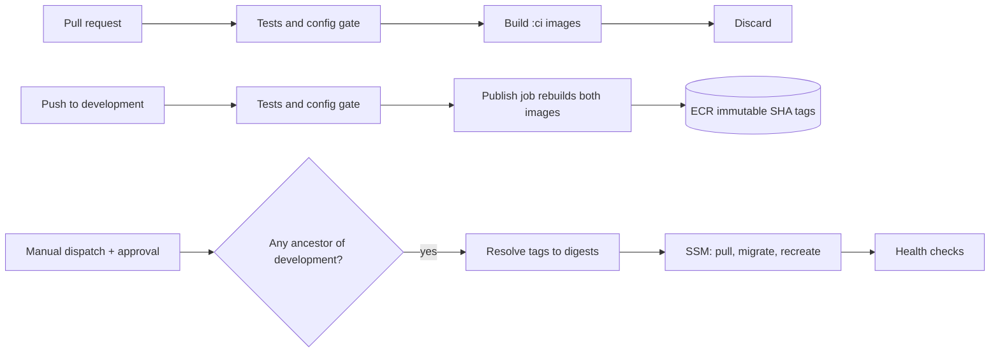
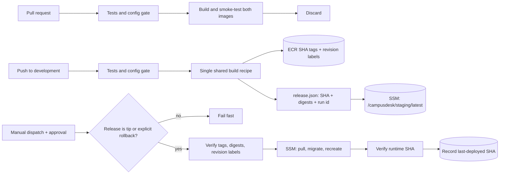
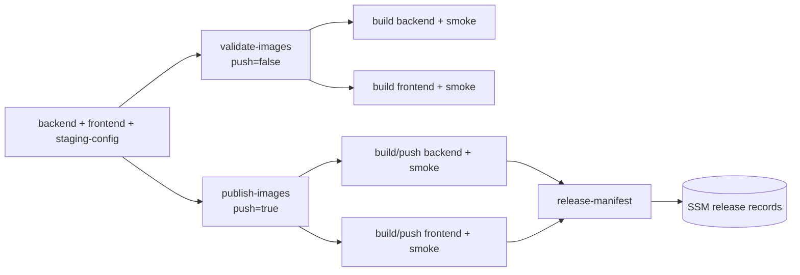

# CampusDesk — CI/CD Hardening Plan

**Last reviewed:** 26 November 2026

**Status:** ✅ All phases complete. Phase 0 closed on staging (20 November 2026); Phase 1 verified (21 November 2026); Phase 2 verified (23 November 2026); Phase 3 verified (24 November 2026); Phase 4 verified (25 November 2026); Phase 5 closed (26 November 2026). `67ea352` is deployed with a passed release scan, the negative mismatch test and rollback exercised, the `VITE_REVERB_APP_KEY` repository variable deleted, and the stale Vite dev-server entry folded into the resolved history.

**Scope:** [.github/workflows/ci.yml](../.github/workflows/ci.yml), [.github/workflows/deploy-staging.yml](../.github/workflows/deploy-staging.yml), [Frontend/Dockerfile](../Frontend/Dockerfile), [campusdesk/Dockerfile](../campusdesk/Dockerfile), [compose.yaml](../compose.yaml), [compose.staging.yaml](../compose.staging.yaml), the host deployment script, and the related documentation.

**Related:** [CI-CD.md](../CI-CD.md) (entry point), [CI/CD implementation and operations guide](CI_CD_SESSION_2_HANDOFF.md), [KNOWN_ISSUES.md](KNOWN_ISSUES.md), [STAGING_RECOVERY.md](STAGING_RECOVERY.md).

This document records five defects found while investigating the 18 November 2026 staging "missing changes" report, explains why each exists and what it can break, and defines a phased, testable plan. Checkboxes are ticked only for work implemented on the branch named below; acceptance tests are ticked only after they pass against staging.

## Status

| Phase | State |
| --- | --- |
| 0 — Instrument and guard | ✅ Closed 20 November 2026; staging acceptance verified, two environment-only checks documented |
| 1 — Release selection guard | ✅ Verified 21 November 2026; five acceptance checks documented as not exercised |
| 2 — One build recipe | ✅ Verified 23 November 2026; three checks documented as not exercised |
| 3 — Reproducible release builds | ✅ Verified 24 November 2026; existing-tag check documented as not exercised |
| 4 — Runtime configuration | ✅ Verified 25 November 2026; repository variable deleted 26 November 2026 |
| 5 — End-to-end release verification | ✅ Closed 26 November 2026; release, scan, negative test, and rollback verified |

---

## 1. Why this plan exists

### 1.1 The incident that triggered it

On 18 November 2026 the operator deployed the `development` tip `79bbf0b` to staging and reported that "a couple of changes" from the theme/notification work were not visible in staging, although the same code was visible locally. The working hypothesis was that a stale or wrong image had been deployed.

### 1.2 What the investigation proved

The staging artefact was correct at every link in the chain:

| Link | Verified evidence |
| --- | --- |
| Running frontend container | `Config.Image` = `…/campusdesk_frontend@sha256:76dcb2b8…` |
| ECR tag `79bbf0b` | resolves to `sha256:76dcb2b8…` (exact match) |
| Deploy action | SSM log shows a fresh digest pull and **Recreate** of `frontend`, `backend`, `worker`, `reverb` — not the no-op path |
| Image contents | the app layer downloaded from ECR contains `index.html` → `index-DGKx_E9Q.js` |
| Commit content in the image | `Mark all read`, `unread`, `badge-orange`, `badge-purple`, the `#main-content:focus` rules from `610f6fc`, and `StaffCaseWorkspace-DQyQwns2.css` |
| Runtime config | staging `REVERB_APP_KEY=campusdesk-key` matches the key baked into the image |

The missing changes were local: the Vite dev server had been serving a stale module graph. Restarting it brought local and staging into sync. This is the same class of staleness already recorded for Tailwind/PostCSS config changes in [KNOWN_ISSUES.md](KNOWN_ISSUES.md).

### 1.3 What the investigation exposed

The incident was **not** a pipeline failure, but four properties of the pipeline made it hard to prove that in less than several hours:

1. an old commit can be deployed as if it were a release;
2. the same image is built by two different recipes;
3. the artefact validated in CI is not the artefact that ships;
4. the pipeline cannot state, in one place, which commit is live.

The five defects in section 3 are the concrete causes of those properties.

---

## 2. Current pipeline (as-is)

### 2.1 Events and jobs

| Event | Quality gates | `backend-image` / `frontend-image` | `backend-publish` / `frontend-publish` |
| --- | --- | --- | --- |
| `pull_request` → `development` | run | run, tagged `:ci`, discarded with the runner | skipped |
| PR merged | — | — | separate `push` run: build jobs skipped, publish jobs rebuild and push |
| `push` → `development` | run | **skipped** (`if: github.event_name != 'push'`) | rebuild and push at the pushed tip |
| `workflow_dispatch` | run | run (throwaway) | skipped |

A merge is seen only as a push: `closed` is not a default `pull_request` activity type, and the publish condition requires `github.event_name == 'push'`.

### 2.2 Image paths

- **PR/validation:** `docker build` → local `campusdesk-{backend,frontend}:ci`, never pushed and never uploaded as an artefact.
- **Release:** `backend-publish` and `frontend-publish` each run their own `docker build` after an ECR existence check, then push `campusdesk_*:<full-sha>`.
- **Deploy:** `deploy-staging.yml` resolves `imageTag=<sha>` in both repositories to digests and passes digest-pinned references to SSM.

### 2.3 Deploy selection

The only release constraint is `git merge-base --is-ancestor "$RELEASE_SHA" HEAD` ([deploy-staging.yml:64](../.github/workflows/deploy-staging.yml#L64)), plus format and existence checks. There is no tip check, no downgrade check, no provenance check, and no ref assertion in the YAML.

### 2.4 Host-side gap

At the time of the investigation, `/usr/local/sbin/campusdesk-deploy` and the `CampusDesk-DeployStaging` SSM document were **not version-controlled in this repository**; their behaviour was known only from [CI_CD_SESSION_2_HANDOFF.md](CI_CD_SESSION_2_HANDOFF.md) (sections "Restricted SSM document" and "Fixed host deployment script"). Phase 0 now tracks both under [`ops/staging/`](../ops/staging/README.md), with the document held as a template and the account ID injected at registration. The host copies are still installed and registered manually.

### 2.5 As-is flow



---

## 3. Defect catalogue

Severity reflects impact if the defect fires, not how often it has fired.

### D1 — Ancestor-only release validation

**Where:** [deploy-staging.yml:47-69](../.github/workflows/deploy-staging.yml#L47-L69), especially line 64.

**What it is:** the deploy accepts any commit reachable from the checked-out `development` tip. It does not require the tip, the newest published release, a forward move, or a CI-produced image.

**Why it exists:** an ancestor check was the cheapest way to reject foreign SHAs. The error text ("not part of the selected development history") implies a stronger guarantee than the code provides.

**Failure modes:**

- silent stale deploy of any past tip — tags are immutable and never expire, so old releases remain deployable forever;
- deploying a post-merge feature commit such as `610f6fc`, `1a11dff`, or `85eed02` passes the git checks but has no image, so the failure surfaces late and with a misleading message;
- no downgrade protection: a rollback and a forward deploy use the same flow and approval;
- `HEAD` is whatever the dispatch was launched from, and the YAML never asserts `github.ref == 'refs/heads/development'`;
- no check that the tags came from a successful CI run for that SHA.

**Severity:** high impact, moderate likelihood. This is the only defect that can silently ship the wrong code.

**Phase 0 status:** the workflow now rejects any dispatch that is not from `refs/heads/development`; the ancestor check itself is unchanged until Phase 1.

### D2 — Duplicated build recipes

**Where:**

- backend: [ci.yml:114-125](../.github/workflows/ci.yml#L114-L125) vs [ci.yml:216-233](../.github/workflows/ci.yml#L216-L233);
- frontend: [ci.yml:141-154](../.github/workflows/ci.yml#L141-L154) vs [ci.yml:295-314](../.github/workflows/ci.yml#L295-L314);
- gating: `if: github.event_name != 'push'` at [ci.yml:102](../.github/workflows/ci.yml#L102) and [:129](../.github/workflows/ci.yml#L129); publish conditions at [:158](../.github/workflows/ci.yml#L158) and [:237](../.github/workflows/ci.yml#L237).

**What it is:** the same two images are built by two independent, hand-maintained command sequences that only one of may run per event.

**Why it exists:** PR build validation predates ECR publishing. When publishing was added, rebuilding in the publish job avoided a second build within one push run, but created a second recipe.

**Failure modes:**

- silent divergence of build args, context, platform, target stage, cache policy, or base image;
- PR CI can be green while the shipped image differs;
- the confusing `if:` conditions are a symptom, not the cause: the workflow encodes "builds are for PRs, publishes are for pushes" as an accident of history;
- drift has already happened once: `0a3c565` had to add `VITE_REVERB_APP_KEY` to both copies.

**Severity:** high impact, high likelihood (already observed).

### D3 — No build-once promotion

**Where:** publish jobs depend only on the test jobs ([ci.yml:159-162](../.github/workflows/ci.yml#L159-L162), [:238-241](../.github/workflows/ci.yml#L238-L241)); no `upload-artifact`, `docker save/load`, or `build-push-action` output is used.

**What it is:** the image validated in CI is discarded; the deployed image is a separate rebuild at a different time on a different runner.

**Why it exists:** simplest model, no cross-job artefact plumbing.

**Failure modes:**

- non-hermetic builds: floating base tags (`node:22-alpine`, `php:8.3-apache`, `nginx:alpine`, `composer:2`) and registry state mean two builds of one commit can differ;
- no durable "tested artefact" to promote, sign, attest, or roll back to;
- release readiness is guesswork: the merge build does not exist until CI finishes, which invites selecting an older SHA (compounding D1);
- promoting a PR build is not automatically safe here: merge commits mean the released tree can differ from the PR head tree if `development` moved.

**Severity:** medium-high, architectural; rarely an immediate outage but it undermines what CI means.

### D4 — Hardcoded Reverb app key

**Where:** literals at [ci.yml:148](../.github/workflows/ci.yml#L148) and [:306](../.github/workflows/ci.yml#L306), defaults at [Frontend/Dockerfile:12](../Frontend/Dockerfile#L12) and [compose.yaml:167](../compose.yaml#L167), the local `Frontend/.env` (untracked as of Phase 0) and [.env.docker.example](../.env.docker.example). Runtime value at [compose.staging.yaml:35](../compose.staging.yaml#L35); the example says [`REPLACE_WITH_RANDOM_KEY`](../.env.staging.example#L24).

**What it is:** a build-time `VITE_*` value is hardcoded in six places instead of derived from one environment-owned source.

**Why it exists:** Vite inlines `VITE_*` at build time; hardcoding the dev value was the quickest way to make realtime work in CI. It works today only because staging also uses `campusdesk-key`.

**Failure modes:**

- rotating `REVERB_APP_KEY` silently kills realtime: the SPA keeps the baked key and the handshake fails while the app still serves;
- the image is environment-coupled and cannot be promoted across environments with different keys;
- six sources of truth can drift;
- baking config into layers is a dangerous precedent for any future secret.

**Severity:** medium today; high on the first key rotation or second environment.

### D5 — Observability

**Where:** the image-reference masks at [deploy-staging.yml:142-143](../.github/workflows/deploy-staging.yml#L142-L143); the deployment summary at [:265-288](../.github/workflows/deploy-staging.yml#L265-L288); host script output; image metadata; application.

**What it is:** the pipeline cannot answer "which commit is staging running, and how was that proven?" Five gaps:

1. no `org.opencontainers.image.revision` label, so image content is not bound to a commit;
2. image references are masked, and the digests had no unmasked record;
3. the host script prints no release SHA, previous release, action taken, or digest;
4. the summary asserts "Host health and API smoke tests: successful" whenever the job is green;
5. there is no `/api/version` and no build SHA in the SPA.

**Why it exists:** each piece was built for a different purpose; no release-record concept exists.

**Failure modes:**

- "wrong image", "host no-op", "cached bundle", and "stale local server" are indistinguishable from outside;
- no audit trail of what was live when;
- D1 cannot be guarded automatically without a last-deployed record;
- silent failures (key mismatch, wrong digest, no-op) all look green.

**Severity:** high — this is the defect that made the other four expensive.

**Phase 0 status:** labels, the host release record (`/opt/campusdesk/release.json`), the identity log, and a verified deploy summary are implemented; `/api/version`, the release manifest, and the last-deployed record remain for Phases 1 and 5.

---

## 4. Target model (to-be)

### 4.1 Principles

1. **One release, one build.** The build that runs for the release commit is the build that ships; PR builds are validation only. (Decision HD-1.)
2. **Identity is content.** Images carry their commit as a label; deployment selects a digest and verifies the label.
3. **Selection is explicit.** Deploying the tip is the default; going backwards is an explicit, logged rollback.
4. **Configuration is runtime, not image.** Environment-specific values are injected at container start, so one image can be promoted.
5. **Every deploy can be interrogated.** A release manifest, an unmasked host record, and a runtime version endpoint answer "what is live?".

### 4.2 Target flow



### 4.3 Contracts

**`release.json`** (CI artefact, and optionally an SSM parameter):

```json
{
  "sha": "79bbf0b1d31d46970495f9eadda994777e61d122",
  "ref": "refs/heads/development",
  "run_id": "1234567890",
  "created_at": "2026-11-18T17:21:21Z",
  "backend":  { "tag": "79bbf0b", "digest": "sha256:…" },
  "frontend": { "tag": "79bbf0b", "digest": "sha256:…" }
}
```

**Image labels:** `org.opencontainers.image.revision`, `.source`, `.version`, `.created`.

**Host record:** `/opt/campusdesk/release.json` (root-owned) with the same SHA and digests, plus `previous_release_sha`.

**Runtime identity:** `GET /api/version` returns `{ "sha": "<build sha>", "built_at": "<timestamp>" }`; the SPA exposes the same value in `meta[name="app-build"]` and `window.__APP_CONFIG__.buildSha`.

### 4.4 Configuration

| Setting | Today | Target |
| --- | --- | --- |
| `VITE_API_URL` | build arg | build arg (same value everywhere) |
| `VITE_REVERB_APP_KEY` | hardcoded build arg | runtime `config.js` generated from container env |
| `REVERB_APP_KEY` | host `.env.staging` | host `.env.staging` (unchanged) |

---

## 5. Decisions

| ID | Decision | Rationale | Revisit when |
| --- | --- | --- | --- |
| HD-1 | Adopt Model A: build once per release commit; PR builds stay validation-only. Model B (PR-built candidate promoted on merge) is deferred. | Model B needs a second ECR repository/role for untrusted PR code and a merge strategy whose tree matches the tested tree. Model A plus D2's shared recipe and D3's digest pinning captures most of the value. | provenance/compliance requires a tested artefact to be promoted, or a merge queue is introduced |
| HD-2 | Default deploy requires the `development` tip; going backwards requires an explicit `allow_previous_release` input with a reason and is logged. | Closes D1 without removing the rollback path. | automated/scheduled deploys are added |
| HD-3 | Reverb key becomes runtime configuration; build args are removed. | Closes D4 and makes the image environment-agnostic. | a build-time value genuinely cannot be runtime (e.g. tree-shaking needs it) |
| HD-4 | The release identity contract is OCI labels + `release.json` + `/api/version`. | Closes D5 and gives D1 something to verify. | an external release system is adopted |
| HD-5 | Do not grant PR workflows push access to the release repositories. | The publish role is scoped to `refs/heads/development`; giving PRs push rights is a security decision, not a convenience. | Model B is explicitly approved with a separate repository/role |

---

## 6. Phases

Each phase is one pull request (or two if a host-script change must be reviewed separately), independently revertible, and complete when the staging acceptance tests pass; environment-only checks are recorded separately.

### Phase 0 — Instrument and guard (no behaviour change)

**Goal:** make every later change provable, and close the cheapest ambiguity with zero runtime risk.

**Prerequisite:** ✅ Host script and SSM document obtained. The reviewed script is tracked at [`ops/staging/campusdesk-deploy.sh`](../ops/staging/campusdesk-deploy.sh) and the version `1` document template at [`ops/staging/CampusDesk-DeployStaging.template.json`](../ops/staging/CampusDesk-DeployStaging.template.json), rendered by [`register-ssm-doc.sh`](../ops/staging/register-ssm-doc.sh) at registration time (the repository remains the source of truth; the host copies are installed manually).

**Tasks:**

- [x] Add OCI labels (`revision`, `source`, `version`, `created`) to both images on both build paths (validation and publication).
- [x] Host script prints `release_sha`, `backend_digest`, `frontend_digest`, `previous_release_sha`, `action=recreate|noop`, and `migration_step_completed`.
- [x] Host script writes `/opt/campusdesk/release.json` (root-owned, mode `0644`; digests, not full image references).
- [x] Deploy summary reports the actual SHA, both digests, and the SSM status; remove unverified claims.
- [x] Add an explicit `github.ref == 'refs/heads/development'` check step in `deploy-staging.yml` (fails the job with a clear message).
- [x] Add a reviewed copy of the host script under `ops/staging/`.
- [x] Capture, review, and template the `CampusDesk-DeployStaging` SSM document; the account ID is injected at registration and never committed.
- [x] Stop tracking `Frontend/.env`; keep `.env.example`; ensure `.gitignore` covers it.
- [x] Document the as-is model ("PR builds validate; the release build happens on the development push") in `CI-CD.md` and the handoff guide.
- [x] Add a runbook line: restart the Vite dev server after changing `tailwind.config.js`, PostCSS config, or design tokens.

**Acceptance tests:**

- [x] `aws ssm get-command-invocation` for a deploy shows `release_sha=<input sha>` and both digests, matching the dispatch input.
- [x] `docker image inspect <ref> --format '{{index .Config.Labels "org.opencontainers.image.revision"}}'` returns the commit for both images.
- [x] `cat /opt/campusdesk/release.json` on the host returns the same SHA.
- [x] `git ls-files Frontend/.env` returns nothing; `.env.example` remains tracked.
- [ ] A clean clone builds and runs locally from `.env.example`.
- [ ] A dispatch from a non-`development` ref is rejected by the job check (or blocked earlier by the `staging` environment) with an explicit message.
- [x] The job summary contains the actual SHA; no line claims a check that was not performed.
- [x] No runtime behaviour changes: the same release deploys and a repeat deploy still takes the no-op path.

**Out of scope:** selection logic, build deduplication, runtime config.

**Rollback:** revert the workflow/doc changes; the host-script additions are additive output only.

**Effort / dependencies:** ~0.5–1 day. ✅ Host script obtained. Needs `ssm:GetCommandInvocation` evidence access; the publish role may write and the deploy role may read `/campusdesk/...` parameters (confirmed).

**Progress (19–20 November 2026):** implemented on `ci/hardening-phase-0`, merged as `4f5c02e`, and verified on staging.

**Verification (20 November 2026):**

- `4f5c02e` deployed; the SSM output printed `release_sha=4f5c02e…`, `backend_digest=sha256:0d83a67d…`, `frontend_digest=sha256:1af30156…`, and `previous_release_sha=79bbf0b…`.
- The host pulled both digests and recreated `frontend`, `backend`, `worker`, and `reverb`; the migration step completed ("Nothing to migrate").
- The deploy summary reported the real SHA, ref, and both digests; no unverified claims.
- A repeat dispatch of the same SHA took the no-op path (`action=noop`, health checks only) and updated the record.
- `git ls-files Frontend/.env` is empty.
- The host-side `docker image inspect` check returned `4f5c02e…` for both images.
- The no-op deploy regenerated `release.json` with `backend_digest`/`frontend_digest`, `migration_step_completed`, and no full image references.
- **Not exercised:** a clean-clone local build (CI built both images from a clean checkout) and the non-`development` dispatch guard (present in code; the `staging` environment also restricts the branch).

**Phase 0.1 (record accuracy, 20 November 2026):** `migration_step_completed` replaces the misleading `migrations_applied` (the migrate command can complete with "Nothing to migrate"), and `/opt/campusdesk/release.json` now stores `backend_digest`/`frontend_digest` rather than full image references so the world-readable record does not expose the registry account ID. The host script was reinstalled and the no-op deploy regenerated the record with the new schema.

**Closed:** 20 November 2026. Phase 0 is complete; Phase 1 starts next.

---

### Phase 1 — Release selection guard

**Goal:** make it impossible to silently deploy a stale or unrelated release, without losing the rollback path.

**Design:** [Phase 1 design records](#phase-1-design--release-selection-guard).

**Tasks:**

- [x] CI writes `release-manifest.json` and uploads it as the artefact `release-<sha>`.
- [x] CI writes `/campusdesk/releases/<sha>` and `/campusdesk/staging/latest`; `latest` is updated only when the SHA is the current `development` tip.
- [x] Deploy fetches `origin/development` explicitly and compares against `origin/development`, not `HEAD`.
- [x] Default: require the SHA to be the tip and the latest published release, with an idempotent exception for re-deploying the current release.
- [x] Add `allow_previous_release` (boolean, default `false`) and `reason` (required when `true`).
- [x] Read `/campusdesk/staging/last-deployed-sha`; normal mode requires it to be an ancestor of the requested SHA (or missing); rollback mode requires the target to be an ancestor of the deployed release and logs the reason.
- [x] Verify the manifest digests against ECR in the workflow.
- [x] Verify `org.opencontainers.image.revision` on the host after pull, before downtime (PR C).
- [x] Record `last_deployed_sha` after a successful deploy (host script, EC2 role `ssm:PutParameter`; PR C).
- [x] Update the operator procedure in `CI-CD.md` and the handoff guide.

**Acceptance tests:**

- [x] Deploying the current tip succeeds.
- [x] Deploying a SHA with no release manifest (for example a pre-PR-A commit such as `d096046`) fails before SSM with the manifest message.
- [x] Deploying a manifest-backed older release with `allow_previous_release=false` fails; with `true` plus a reason it succeeds and the run records a rollback.
- [ ] A rollback target newer than the deployed release is rejected.
- [ ] A manifest/ECR digest mismatch fails before SSM.
- [ ] A host image whose revision label does not match fails after pull, before downtime (PR C).
- [ ] A second deploy of the same SHA reports the no-op path and still records health and smoke results.
- [ ] A deploy of a SHA that is not an ancestor still fails with the existing message.

**Out of scope:** automated deployment on publish; multi-environment promotion.

**Rollback:** revert to the previous workflow version; `allow_previous_release` can be flipped off independently of the rest.

**Effort / dependencies:** ~1 day. IAM applied: the publisher writes manifests, the deploy role reads all three parameter paths, and the EC2 role writes `last-deployed-sha` only.

**Progress (21 November 2026):** PR A verified in run #64; PR B verified normal/rollback/no-manifest; PR C implemented, its host script installed, and the EC2 IAM policy applied.

**Verification (21 November 2026):**

- PR A: run #64 published `56cd835`; `/campusdesk/staging/latest` matched; artifact `release-56cd835…` existed.
- PR B: `a822327` deployed as `normal`; `56cd835` without the flag was rejected; the same SHA with `allow_previous_release=true` and a reason deployed as `rollback`; `d096046` failed at the manifest lookup.
- PR C: `a28ed154` deployed as `normal` with `Deployment record: verified`; a repeat showed `Previously deployed: a28ed154` and verified; `56cd835` rolled back with `Selection: rollback` and verified; the `a28ed154` restore showed `Previously deployed: 56cd835` and verified.
- IAM: the policy simulator allows `ssm:PutParameter` for `CampusDeskEc2Runtime`; `AmazonSSMManagedInstanceCore` does not grant it. The simulator reports two allowing statements, so inspect the other identity policies for a broad `PutParameter` grant.
- **Not exercised:** a rollback target newer than the deployed release; a manifest/ECR digest mismatch; a host image label mismatch; a non-ancestor dispatch; and the host action for the repeat deploy (the summary reports success and the record, not the action).

**Closed:** 21 November 2026. Phase 1 is complete; Phase 2 starts next.

---

### Phase 2 — One build recipe

**Goal:** remove the possibility of PR validation and release publication diverging.

**Design:** [Phase 2 design records](#phase-2-design--one-build-recipe).

**Tasks:**

- [x] Add `.github/workflows/build-images.yml` with `workflow_call` inputs `push` and `image_tag`.
- [x] Steps: checkout, `docker/setup-buildx-action`, conditional ECR login, `docker/build-push-action` with shared `context`, `build-args`, `labels`, `tags`.
- [x] Frontend build args defined once; source the Reverb key from `vars.VITE_REVERB_APP_KEY` (removed entirely in Phase 4).
- [x] Replace the four `docker build` invocations with calls to the reusable workflow.
- [x] PR path: build only (`load: true`), plus a container smoke test (`/up` for Laravel, `/` for Nginx).
- [x] Release path: build, smoke test, and push; reuse an existing immutable tag without rebuilding.
- [x] Rename jobs to state their role ("Validate images (PR)", "Publish release images (development)") and remove the misleading conditional comments.

**Acceptance tests:**

- [x] `grep -rn "docker build" .github/` returns no matches.
- [x] `grep -rn "VITE_API_URL" .github/` returns exactly one definition.
- [x] A PR run builds both images and makes no ECR call (no OIDC assumption).
- [x] A `development` push builds and pushes both images with identical inputs to the PR path.
- [ ] The smoke test fails the job when the served page returns a non-200 status.
- [ ] A registry-pull failure fails the job instead of being retried into a green state.
- [ ] A rerun of the same push takes the existing-tag path and the manifest job succeeds without rebuilding.

**Out of scope:** changing the release model (HD-1), publishing from PRs.

**Rollback:** restore `ci.yml` from Git; the reusable workflow can remain unused.

**Effort / dependencies:** ~1–2 days. Depends on Phase 0 labels to keep the contract stable.

**Progress (23 November 2026):** implemented on `ci/build-recipe` — the reusable `build-images.yml`, the `validate-images`/`publish-images` callers, the manifest job consuming the caller digests, a single build-arg definition, immutable-tag reuse, and container smoke tests.

**Verification (23 November 2026):**

- PR #34 / CI #69: `validate-images` built both images and the publish/manifest jobs were skipped; two artifacts.
- Merge `0b8e9ef` / CI #70: `publish-images` built and pushed both images; `release-manifest` succeeded with `Latest parameter updated: true`; three artifacts.
- Deploy: `0b8e9ef` selected `normal`; latest matched; previous `a28ed154`; release manifest verified; deployment record verified.
- Build inputs: `VITE_API_URL=/api` and `VITE_REVERB_APP_KEY=campusdesk-key`; the `revision` label matched the PR SHA and the merge SHA; PR images were local `:ci` tags and push images were ECR SHA tags.
- **Not exercised:** a non-200 smoke test; a non-`ImageNotFoundException` ECR error; and an existing-tag rerun.

**Closed:** 23 November 2026. Phase 2 is complete; Phase 3 starts next.

---

### Phase 3 — Reproducible release builds

**Goal:** make "the tested build" and "the shipped build" differ only by recipe, and make the recipe deterministic.

**Design:** [Phase 3 design records](#phase-3-design--reproducible-release-builds).

**Tasks:**

- [x] Digest-pin every base image in both Dockerfiles (`node:22-alpine@sha256:…`, `php:8.3-apache@sha256:…`, `nginx:alpine@sha256:…`, `composer:2@sha256:…`), including an explicit composer stage.
- [x] Add `provenance: mode=max` and `sbom: true` to the release build.
- [x] Document Model A (release build = development push build; PR build = validation) in `CI-CD.md`.
- [x] Record the digests in `release.json` (the index digest; already required by Phase 1).
- [x] Add `.github/dependabot.yml` for the Docker and GitHub Actions ecosystems.
- [x] Add `verify-reproducibility.yml` (manual dispatch) comparing two cold builds of the same commit.
- [x] Add the pushed-digest smoke test; an existing tag is pulled and smoke-tested before publication.
- [x] Add `ecr:GetDownloadUrlForLayer` to the publisher role's repository actions (applied 24 November 2026).
- [x] Merge the fix and dependency updates; the release push runs succeeded.

**Vulnerability scanning:** deferred to Phase 5 (`trivy`/`grype` on the pushed digest).

**Acceptance tests:**

- [x] Every external image reference is pinned: every `FROM` and external `COPY --from` has `@sha256:` (the composer reference is now a pinned stage).
- [x] Two dispatched builds of the same commit produce identical frontend file hashes (`sha256sum /usr/share/nginx/html/index.html` and the `index-*.js` asset) and identical backend application file hashes.
- [x] `docker buildx imagetools inspect <image>` shows both the provenance and SBOM attestations.
- [x] `release.json` digests match the images that were actually pushed.
- [x] The smoke test runs on the pushed digest and the recorded digest equals the tested digest.
- [ ] An existing immutable tag is pulled and smoke-tested before publication (the fix is active, but the existing-tag path has not yet been exercised).
- [x] The PR path still builds both images with no ECR call, no OIDC, and no attestations.
- [x] The build-push-action 7, setup-buildx 4, artifact action 7/8, and Node 26 updates pass a release push.
- [x] The deploy of the release SHA succeeds with the index digest and the record verifies.

**Out of scope:** bit-for-bit identical image digests (timestamps and layer ordering are outside scope).

**Rollback:** revert the Dockerfiles; labels and provenance are additive.

**Effort / dependencies:** ~1–2 days. Depends on Phase 2 (single build path).

**Progress (24 November 2026):** implemented on `ci/reproducible-builds` — pinned bases with an explicit composer stage, Option A attestations (`mode=max` + SBOM) with a pushed-digest smoke test, the `verify-reproducibility` dispatch, Dependabot, and the Model A documentation. PR #42 and Dependabot PRs #37–#41 are merged; push runs #84–#88 succeeded. `b4c8659` was deployed as `normal` with latest matched, previous `0b8e9ef`, the release manifest verified, SSM success, and the deployment record verified.

The `4a13764` images' attestation manifests contain both the SPDX SBOM and the SLSA v1 provenance layers; the image index digests match `backend.digest`/`frontend.digest`. `Verify reproducibility` run #1 passed on `b4c8659` with eight artifacts and matching backend/frontend file hashes.

**Not exercised:** the existing-tag pull/smoke path. The fix is active; a rerun of a completed push would exercise it without rebuilding.

The pre-fix `be6c69d…` release was produced by the old existing-tag path; if its smoke step was skipped, treat it as untested and do not use it as a rollback target until it is re-tested.

---

### Phase 4 — Runtime configuration for the Reverb key

**Goal:** make the image environment-agnostic so one artefact can be promoted and rotation cannot silently break realtime.

**Design:** [Phase 4 design records](#phase-4-design--runtime-reverb-configuration).

**Tasks:**

- [x] Add an nginx entrypoint that writes `/usr/share/nginx/html/config.js` from container environment (`REVERB_APP_KEY`, using `jq`).
- [x] Load `config.js` before the app bundle in `Frontend/index.html`.
- [x] Change [echo.ts:88-91](../Frontend/src/services/echo.ts#L88-L91) to prefer `window.__APP_CONFIG__` and fall back to `import.meta.env` for local development.
- [x] Serve `config.js` with `Cache-Control: no-store`; keep the SPA fallback behaviour.
- [x] Remove `VITE_REVERB_APP_KEY` from the Dockerfile, the reusable workflow, and `compose.yaml`; keep `VITE_API_URL`.
- [x] Write the rotation runbook: change host env → recreate `reverb`, `backend`, `worker`, `realtime-worker`, `frontend` → verify a websocket connects.
- [x] Replace the baked-key preflight with a post-start host check that the generated `config.js` matches the host key and is served no-store.
- [x] Add graceful SPA degradation when `config.js` is missing (Echo factory throws; realtime disabled).
- [x] Add Echo/config tests for runtime precedence, build fallback, and no-key behavior.
- [x] Install the updated `compose.staging.yaml` and host deployment script on the staging host.
- [x] Delete the unused `VITE_REVERB_APP_KEY` repository variable.

**Acceptance tests:**

- [x] Rotating `REVERB_APP_KEY` in `/opt/campusdesk/.env.staging` and recreating the containers keeps realtime working with no image rebuild.
- [x] `curl -sI http://127.0.0.1:8080/config.js` returns `200` and `Cache-Control: no-store`.
- [x] The same image runs locally and in staging with different keys.
- [x] `grep -rn "campusdesk-key" .github/ Frontend/Dockerfile compose.yaml` returns no matches (examples and docs may still show a placeholder).
- [x] The SPA still boots when `config.js` is missing (fallback path).

**Out of scope:** rotating the Reverb app secret (host-only, never in the image).

**Rollback:** restore the build-arg path; the `echo.ts` fallback keeps local development working either way.

**Effort / dependencies:** ~1–2 days. Depends on Phase 2 (single build path) and Phase 0 (deploy preflight output).

**Progress (25 November 2026):** implemented on `feat/runtime-reverb-key` — key-free frontend image, nginx `config.js` entrypoint with `jq`, no-store config/index, runtime Echo precedence with graceful degradation, Compose/host key wiring, and the post-start host check. The first deploy of `8c8fed` failed because the staging host Compose lacked the frontend `REVERB_APP_KEY`; installing the reviewed `compose.staging.yaml` and host script fixed it, and the redeploy succeeded.

**Verification (25 November 2026):**

- `8c8fed` deployed as `normal`; latest matched; previous `b4c8659`; release manifest verified; SSM success; deployment record verified.
- The staging app key was rotated to `campusdesk-461a0bb9080ea6190e64dbfba3dee31d` (public client key; the app secret is separate), and `reverb`, `backend`, `worker`, `realtime-worker`, and `frontend` were recreated. No image rebuild occurred; the frontend image remained `473224a08684`.
- `config.js` served the new key with HTTP `200` and `Cache-Control: no-store`.
- The browser WebSocket returned `101 Switching Protocols`, subscribed to `private-users.621`, received a `request.created` event, and exchanged ping/pong frames.
- The same staging image, run with `local-check-key` on port `8081`, served that different key with `no-store`, proving the image is key-free.
- The hardcoded-key grep is empty for `.github/`, `Frontend/Dockerfile`, and `compose.yaml`; the Echo tests cover the missing-`config.js` fallback.

The Browser console showed two extension/content-script `runtime.lastError` messages; they are not application errors. The WebSocket subscription and event prove the app's realtime path works.

**Cleanup:** the unused `VITE_REVERB_APP_KEY` repository variable was deleted on 26 November 2026.

---

### Phase 5 — End-to-end release verification

**Goal:** prove, on every deploy, that the running application is the requested commit.

**Design:** [Phase 5 design records](#phase-5-design--end-to-end-release-verification).

**Tasks:**

- [x] Bake `APP_BUILD_SHA` and the commit-timestamp `APP_BUILD_TIME` into the backend image.
- [x] Add `GET /api/version` returning both values (public, no secrets).
- [x] Expose the frontend build SHA in `meta[name="app-build"]` and `window.__APP_CONFIG__.buildSha`.
- [x] Add a host `verify_runtime_sha` check: compare `/api/version`, the frontend config, and the SPA meta with `RELEASE_SHA`; fail on mismatch.
- [x] Replace the hardcoded summary lines with step outputs and the host's verified runtime identity.
- [x] Add the Trivy `scan-release` job and release-manifest scan status (PR B).
- [x] Remediate the scan findings (Composer PHPUnit platform; `libzstd1` base image).
- [x] Update `CI_CD_SESSION_2_HANDOFF.md`, `CI-CD.md`, and `KNOWN_ISSUES.md` (stale dev server entry).
- [x] Exercise the rollback and key-rotation runbooks once end to end.
- [x] Run the negative mismatch test (fake `deadbeef` image vs the deployed `67ea352`).

**Acceptance tests:**

- [x] `curl -fsS http://127.0.0.1:8080/api/version` on the host returns the deployed SHA.
- [x] A deploy whose runtime SHA does not match the requested SHA fails the workflow with a clear message.
- [x] The SPA's `meta[name="app-build"]` matches the same SHA.
- [x] The release vulnerability scan completes and its report is recorded.
- [x] The rollback runbook and the key-rotation runbook have both been executed successfully.
- [x] The summary contains only verified facts.

**Out of scope:** dashboards, alerting, canary or blue/green deployment.

**Rollback:** make the verification step warn-only if it proves too strict; the endpoint is additive.

**Effort / dependencies:** ~1 day. Depends on Phases 1 and 4.

**Progress (26 November 2026):** Phase 5 closed. PR A verified `099e16`; PR B merged; the Trivy gate blocked `a211508`; the remediated `289b700` passed; `67ea352` was deployed as `normal` with latest matched and previous `099e16`; `/api/version` returned `67ea352` built `2026-11-26T13:40:29+01:00`; the SPA meta and `release.json` (`build_sha`, `build_time`, `frontend_build_sha`, `frontend_meta_sha`, `scan_status=passed`) matched; the negative mismatch test produced the expected host failure; the rollback was exercised; the `VITE_REVERB_APP_KEY` variable was deleted; the Vite dev-server entry was folded into the resolved history.

---

## 7. Phase design records

The five former phase design documents are merged here. The phase sections above remain the implementation and acceptance record; these sections preserve the original design rationale, decisions, rollout details, and risks.

### Phase 1 design — Release Selection Guard


**Last reviewed:** 21 November 2026

**Status:** ✅ Verified 21 November 2026 — PR A (run #64), PR B (normal/rollback/no-manifest), and PR C (`a28ed154` normal with record verified, repeat, rollback `56cd835`, restore). Phase 2 is next.

**Scope:** [.github/workflows/ci.yml](../.github/workflows/ci.yml), [.github/workflows/deploy-staging.yml](../.github/workflows/deploy-staging.yml), [ops/staging/campusdesk-deploy.sh](../ops/staging/campusdesk-deploy.sh), IAM for the publisher, deploy, and EC2 runtime roles, and the operator documentation.

**Related:** [Phase design records](#phase-design-records), [CI/CD implementation and operations guide](CI_CD_SESSION_2_HANDOFF.md), [CI-CD.md](../CI-CD.md).

#### 1. Objective

Make a stale or unrelated release impossible to deploy silently, while keeping the deliberate rollback path and the manual approval gate.

After Phase 1:

1. A deploy is accepted only if a CI-produced release manifest exists for that exact SHA.
2. In normal mode the SHA must be the current `development` tip **and** the latest published release.
3. Going backwards requires `allow_previous_release=true` plus a reason, and the target must be older than what is currently deployed.
4. The manifest digests must match ECR, and the pulled images must carry `org.opencontainers.image.revision == SHA`.
5. The host records the deployed SHA in SSM after a successful deploy; the workflow verifies it.

#### 2. Non-goals

- Changing the build recipe (Phase 2).
- Runtime configuration (Phase 4).
- Zero-downtime, canary, or blue/green deployment.
- Automatic deployment on publish.

#### 3. Release records

Three SSM `String` parameters in `eu-north-1`, all free of secrets and account identifiers:

| Parameter | Written by | Read by | Value |
| --- | --- | --- | --- |
| `/campusdesk/releases/<sha>` | publisher role (CI manifest job) | deploy role | JSON release manifest |
| `/campusdesk/staging/latest` | publisher role, only when the published SHA is the current `development` tip | deploy role | the SHA of the newest published release |
| `/campusdesk/staging/last-deployed-sha` | **EC2 instance role** (host script) | deploy role | the SHA of the last successful deployment |

`PutParameter --overwrite` creates each parameter if absent. No KMS permission is required for `String` parameters under the default SSM key. CloudTrail records every write.

##### Manifest schema

`release-manifest.json`, also uploaded as the workflow artefact `release-<sha>` (90 days):

```json
{
  "schema": 1,
  "sha": "<40-hex>",
  "ref": "refs/heads/development",
  "run_id": "1234567890",
  "run_attempt": "1",
  "created_at": "2026-11-21T15:00:00Z",
  "backend": {
    "repository": "campusdesk_backend",
    "tag": "<40-hex>",
    "digest": "sha256:…"
  },
  "frontend": {
    "repository": "campusdesk_frontend",
    "tag": "<40-hex>",
    "digest": "sha256:…"
  }
}
```

The manifest contains no account ID; the deploy builds the registry reference from `vars.AWS_ACCOUNT_ID` as it does today.

##### The `latest` tip guard

The manifest job writes `/campusdesk/staging/latest` only when the release SHA is the current `origin/development` tip at write time. A CI re-run of an older push still writes its per-SHA manifest but does not move `latest` backwards. If a newer push lands while the job runs, the newer push's manifest job owns `latest`.

#### 4. Selection rules

| Mode | Entered when | Conditions |
| --- | --- | --- |
| **normal** | default | `sha == origin/development` tip, `sha == /staging/latest`, and `last-deployed` is an ancestor of `sha` (or unknown) |
| **idempotent** | default | `sha == last-deployed` (re-run or health check even if the tip moved) |
| **rollback** | `allow_previous_release=true` + non-empty `reason` | `sha` is a published ancestor of `development` and an ancestor of `last-deployed` (or `last-deployed` is unknown during bootstrap) |

Failure messages name the values, for example:

- `4f5c02e is not the current development tip (tip is ff258aa); use allow_previous_release for a rollback`
- `no published release manifest for <sha>; wait for the publish job to finish`
- `<sha> is not the latest published release (latest is <sha>)`
- `<sha> is not older than the deployed release <sha>; rollback targets must be ancestors of the deployed release`
- `allow_previous_release requires a non-empty reason`

#### 5. PR A — release manifest publication (implemented)

**Goal:** every successful push publication produces an immutable per-release manifest and updates `latest` safely. Deployment still behaves exactly as before.

**CI changes:**

- `backend-publish` and `frontend-publish` gain job output `digest`.
- A `Resolve published digest` step runs after the build/push step, whether the image was just pushed or already existed, and validates `^sha256:[0-9a-f]{64}$`.
- A new `release-manifest` job runs on a push to `development` after both publish jobs:
  1. checks out the repository with full history;
  2. assumes the publisher role;
  3. validates the SHA and both digests;
  4. writes `release-manifest.json` with `jq`;
  5. writes `/campusdesk/releases/<sha>`;
  6. writes `/campusdesk/staging/latest` only if `<sha>` is the current `origin/development` tip;
  7. uploads the artefact `release-<sha>`;
  8. writes a job summary including the manifest and `latest_updated`.

**IAM prerequisite (publisher role only):** `ssm:PutParameter` on `/campusdesk/releases/*` and `/campusdesk/staging/latest`. This is applied manually before the first push after PR A merges.

**Acceptance:**

- Both publish jobs green; `release-manifest` green on a `development` push.
- `/campusdesk/releases/<sha>` contains the manifest with both digests.
- `/campusdesk/staging/latest` equals the SHA when it was the tip.
- Artefact `release-<sha>` exists.
- A re-run of an older CI run does not move `latest`.
- No deploy behaviour changes.
- **Verified 21 November 2026:** run #64 published `56cd835…`, `latest` matches, and artifact `release-56cd835…` exists.

#### 6. PR B — deploy selection

**New inputs:**

```yaml
allow_previous_release:
  description: Deploy a published release older than the current deployment (rollback)
  required: false
  default: false
  type: boolean
reason:
  description: Required when allow_previous_release is true
  required: false
  default: ""
  type: string
```

**New step `Resolve release manifest`** (replaces `Verify release images`):

- read `/campusdesk/releases/<sha>`; missing → fail with "no published release manifest";
- validate the manifest SHA and both digests;
- cross-check both ECR tags resolve to the same digests;
- read `/campusdesk/staging/latest`;
- read `/campusdesk/staging/last-deployed-sha` tolerantly (missing = `unknown`);
- output `backend_digest`, `frontend_digest`, `latest_sha`, `last_deployed_sha`.

**New step `Apply release selection`:**

```bash
git fetch --no-tags origin +refs/heads/development:refs/remotes/origin/development
tip="$(git rev-parse origin/development)"

if [[ "$RELEASE_SHA" == "$tip" && "$RELEASE_SHA" == "$LATEST_SHA" ]]; then
    mode="normal"
elif [[ "$RELEASE_SHA" == "$LAST_DEPLOYED_SHA" ]]; then
    mode="idempotent"
elif [[ "$ALLOW_PREVIOUS" == "true" ]]; then
    [[ -n "$REASON" ]] || fail "allow_previous_release requires a non-empty reason"
    [[ "$LAST_DEPLOYED_SHA" == "unknown" ]] ||
        git merge-base --is-ancestor "$RELEASE_SHA" "$LAST_DEPLOYED_SHA" ||
        fail "rollback targets must be ancestors of the deployed release"
    mode="rollback"
else
    fail "not the tip/latest; use allow_previous_release for a rollback"
fi
```

**New step `Verify deployment record`** after the SSM wait:

```bash
recorded="$(aws ssm get-parameter --name /campusdesk/staging/last-deployed-sha \
  --query Parameter.Value --output text)"
[[ "$recorded" == "$RELEASE_SHA" ]] || fail "deployment record does not match the release"
```

**Summary additions:** selection mode, tip, latest, previous deployed, rollback reason, digests.

Until PR C installs the host-side write, `/campusdesk/staging/last-deployed-sha` is absent; the workflow treats it as `unknown` for selection and reports `record_status=skipped` for the post-deploy check. Once PR C is installed, a successful host deploy writes the parameter and the check enforces equality.

**IAM prerequisite (deploy role):** `ssm:GetParameter` on the three parameter paths.

**Verified 21 November 2026:** `a822327…` deployed as `normal`; `56cd835…` without the flag was rejected; the same SHA with `allow_previous_release=true` and a reason deployed as `rollback`; `d096046…` failed at the manifest lookup.

#### 7. PR C — host record and label verification

**Host script changes:**

1. **Verify image labels after pull, before downtime:**

   ```bash
   verify_image_revision() {
       local image="$1" revision
       revision="$(docker image inspect "$image" \
           --format '{{index .Config.Labels "org.opencontainers.image.revision"}}')"
       [[ "$revision" == "$release_sha" ]] ||
           die "Image ${image} declares revision '${revision}', expected ${release_sha}"
   }
   ```

2. **Record the deployed SHA** after `write_state` and `write_release_record` on both the no-op and recreate success paths:

   ```bash
   readonly LAST_DEPLOYED_PARAMETER="/campusdesk/staging/last-deployed-sha"

   record_last_deployed() {
       aws ssm put-parameter --region "$AWS_REGION" \
           --name "$LAST_DEPLOYED_PARAMETER" --type String \
           --value "$release_sha" --overwrite >/dev/null
   }
   ```

   On failure, log `application is deployed but the release record could not be updated` and exit 1. The app stays healthy; the SSM command fails so the workflow surfaces the problem.

3. **No-op verifies the running containers, not only `.env.staging`.** If the recorded refs match but the running `Config.Image` values do not, fall through to a recreate instead of no-op'ing over a stale stack.

**IAM prerequisite (EC2 instance role):** `ssm:PutParameter` on `/campusdesk/staging/last-deployed-sha` only.

**Rollout:** install the updated host script, then deploy the current tip normally; the host writes `last-deployed-sha`. Until then the workflow treats it as `unknown`.

**Verified 21 November 2026:** `a28ed154…` deployed as `normal` and the workflow reported `Deployment record: verified`; a repeat reported `Previously deployed: a28ed154…`; `56cd835…` rolled back with `Selection: rollback` and a verified record; the `a28ed154…` restore reported `Previously deployed: 56cd835…`. The EC2 policy simulator allows `ssm:PutParameter`; `AmazonSSMManagedInstanceCore` does not grant it, but the simulator reports two allowing statements, so inspect the other identity policies for a broad `PutParameter` grant.

#### 8. IAM changes

All are additive statements on existing roles. `<ACCOUNT_ID>` is substituted at apply time and never committed.

**Publisher role** (`CampusDeskGitHubEcrPublisher`) — required before PR A's first push:

```json
{
  "Sid": "WriteReleaseManifests",
  "Effect": "Allow",
  "Action": "ssm:PutParameter",
  "Resource": [
    "arn:aws:ssm:eu-north-1:<ACCOUNT_ID>:parameter/campusdesk/releases/*",
    "arn:aws:ssm:eu-north-1:<ACCOUNT_ID>:parameter/campusdesk/staging/latest"
  ]
}
```

**Deploy role** (`CampusDeskGitHubStagingDeployer`) — PR B:

```json
{
  "Sid": "ReadReleaseRecords",
  "Effect": "Allow",
  "Action": "ssm:GetParameter",
  "Resource": [
    "arn:aws:ssm:eu-north-1:<ACCOUNT_ID>:parameter/campusdesk/releases/*",
    "arn:aws:ssm:eu-north-1:<ACCOUNT_ID>:parameter/campusdesk/staging/latest",
    "arn:aws:ssm:eu-north-1:<ACCOUNT_ID>:parameter/campusdesk/staging/last-deployed-sha"
  ]
}
```

**EC2 instance role** (`CampusDeskEc2Runtime`) — PR C:

```json
{
  "Sid": "WriteLastDeployedRelease",
  "Effect": "Allow",
  "Action": "ssm:PutParameter",
  "Resource": "arn:aws:ssm:eu-north-1:<ACCOUNT_ID>:parameter/campusdesk/staging/last-deployed-sha"
}
```

`AmazonSSMManagedInstanceCore` grants `GetParameter*` but, as far as known, not `PutParameter`; confirm before relying on the scoped statement. If it does grant `PutParameter`, the statement is additive rather than restrictive and needs a different control (permissions boundary or a dedicated role). The 21 November simulator run reported two allowing statements for the last-deployed parameter, so inspect the other identity policies for a broad grant.

#### 9. Failure modes

| Situation | Behaviour |
| --- | --- |
| Publish run failed / no manifest | Deploy fails before SSM |
| Manifest exists but ECR digest differs | Deploy fails before SSM |
| Tip moved after publish | Normal deploy of the older SHA fails; use `allow_previous_release` or deploy the new tip |
| Unpublished feature commit | Fails at the manifest lookup, not at ECR |
| Rollback without reason / to a newer release | Fails with a specific message |
| Host `PutParameter` fails | App stays up; SSM command fails; workflow reports the record failure |
| Host image label mismatch | Fails after pull, before downtime |
| No-op while containers are stale | Falls through to a recreate |
| Missing `last-deployed-sha` | Treated as `unknown`; bootstrap allowed; post-deploy check reports `skipped` until PR C |

#### 10. Rollout and test plan

1. Apply the publisher IAM statement.
2. Merge PR A; confirm the manifest for the merge commit and `latest`.
3. Merge PR B and the deploy-role IAM statement.
4. Merge PR C and the EC2 IAM statement; install the host script.
5. Deploy the current tip: normal mode, success, `last-deployed-sha` written.
6. Repeat the same SHA: idempotent, host no-op.
7. Negative tests: a pre-PR-A SHA with no manifest fails at the manifest lookup; a manifest-backed older release without the flag fails the selection; with the flag and a reason it succeeds as a rollback; a feature commit with no manifest fails.

Releases published before PR A have no manifest and cannot be deployed. Rollback targets must be post-PR-A releases, so exercising a rollback needs at least two manifest-backed releases (for example, deploy a release newer than `56cd835`, then roll back to `56cd835`).

| Test | Expected |
| --- | --- |
| Normal deploy of the tip | Success; record updated |
| Repeat the same SHA | `idempotent`; no-op |
| Pre-PR-A SHA (no manifest), e.g. `d096046` | Fail: no published manifest |
| Manifest-backed older release without flag | Fail: not the tip/latest |
| Manifest-backed older release + flag + reason | Rollback success; record = target; redeploy tip to restore |
| Feature commit with no manifest | Fail: no manifest |
| Manifest/ECR mismatch | Fail before SSM |
| Host label mismatch | Fail after pull, before downtime (PR C) |
| Manual container drift | Recreate, not no-op (PR C) |

#### 11. Decisions

| Decision | Choice |
| --- | --- |
| Idempotent re-deploy | Allow `sha == last-deployed` even when it is no longer the tip |
| Rollback target | Must be an ancestor of `last-deployed` |
| Manifest artefact | `release-manifest.json`, artifact `release-<sha>` |
| `latest` guard | Update only when the SHA is the current tip |
| Publisher IAM | Manual console/CLI change, documented with `<ACCOUNT_ID>` |
| Deployed record writer | EC2 instance role, host script after success |
| Deploy role | Read-only on release records |
| Label verification | Host-side after pull, before downtime |
| No-op verification | Running containers must match the recorded references |
| IaC | No IAM IaC in the repository; changes are applied manually |

#### 12. PR split

| PR | Branch | Contents |
| --- | --- | --- |
| A | `ci/release-manifest` | CI manifest job, publish digest outputs, publisher IAM statement, design doc |
| B | `ci/deploy-selection` | Deploy inputs/rules/manifest resolution/record verification, deploy-role IAM |
| C | `ops/last-deployed-record` | Host label check, `last-deployed` write, running-container check, EC2 IAM, host reinstall |
| D | docs | Operator procedure, rollback runbook, plan update |

#### 13. References

- [CI/CD Hardening Plan](CI_CD_HARDENING_PLAN.md) — defect catalogue and phase plan.
- [CI/CD implementation and operations guide](CI_CD_SESSION_2_HANDOFF.md) — current pipeline, IAM, EC2, and deploy procedure.
- [.github/workflows/ci.yml](../.github/workflows/ci.yml) — publish and manifest jobs.
- [.github/workflows/deploy-staging.yml](../.github/workflows/deploy-staging.yml) — deploy selection (PR B).
- [ops/staging/campusdesk-deploy.sh](../ops/staging/campusdesk-deploy.sh) — host record and label checks (PR C).

### Phase 2 design — One Build Recipe


**Last reviewed:** 23 November 2026

**Status:** ✅ Verified 23 November 2026 — PR #34/CI #69 validated the PR path; merge `0b8e9ef`/CI #70 published both images and the manifest; the deploy verified. Phase 3 is next.

**Scope:** [.github/workflows/ci.yml](../.github/workflows/ci.yml), [.github/workflows/build-images.yml](../.github/workflows/build-images.yml), the frontend test job's local build environment, and the CI documentation.

**Related:** [Phase design records](#phase-design-records), [CI/CD implementation and operations guide](CI_CD_SESSION_2_HANDOFF.md), [CI-CD.md](../CI-CD.md).

#### 1. Objective

The image build exists once and is used by both the PR validation path and the release publication path, so the validated build and the shipped build cannot diverge.

Today the backend and frontend images are built by four hand-maintained commands: `backend-image`/`frontend-image` for pull requests and `backend-publish`/`frontend-publish` for `development` pushes. The publish copies carry the same Dockerfile, labels, and frontend build arguments as the validation copies, but each must be changed independently. That already drifted once in `0a3c565`, when the Reverb key had to be added to both.

#### 2. Non-goals

- Digest-pinning base images, provenance, and SBOM (Phase 3).
- Runtime Reverb configuration (Phase 4).
- Changing the release model: PR builds stay validation-only, and the release build still runs on the `development` push.

#### 3. Target architecture

One reusable workflow, two caller jobs:



- [`.github/workflows/build-images.yml`](../.github/workflows/build-images.yml) is the single recipe, exposed with `workflow_call`.
- `ci.yml` calls it twice:
  - `validate-images` on pull requests (and manual non-push runs) with `push: false`;
  - `publish-images` on a `development` push with `push: true`.
- `release-manifest` changes from `needs: [backend-publish, frontend-publish]` to `needs: publish-images`, consuming that caller's digests.
- [deploy-staging.yml](../.github/workflows/deploy-staging.yml), the SSM document, and the host script are unchanged.

This diagram was rendered successfully with mermaid.ink and Kroki on 23 November 2026.

#### 4. Reusable workflow interface

```yaml
on:
  workflow_call:
    inputs:
      push:
        required: true
        type: boolean
      image_tag:
        required: true
        type: string
    outputs:
      backend_digest:
        value: ${{ jobs.backend.outputs.digest }}
      frontend_digest:
        value: ${{ jobs.frontend.outputs.digest }}
```

Inside, two jobs (`backend`, `frontend`), each exposing `digest: ${{ steps.publish.outputs.digest }}`.

**Permissions:** the caller job controls them; the reusable workflow does not declare a narrower `permissions` block, so the push caller's `id-token: write` is available to the AWS steps. The PR caller grants only `contents: read`, and every AWS step is conditional on `inputs.push`, so no OIDC token is requested on the PR path.

**Contexts:** `vars.AWS_ROLE_ARN`, `vars.AWS_REGION`, `vars.AWS_ACCOUNT_ID`, `vars.ECR_BACKEND_REPOSITORY`, `vars.ECR_FRONTEND_REPOSITORY`, `vars.VITE_REVERB_APP_KEY`.

#### 5. Per-image job flow

1. Check out the repository.
2. Set up Docker Buildx.
3. If `push`, configure AWS credentials (publisher role) and log in to ECR.
4. If `push`, check the immutable tag with `aws ecr describe-images`:
   - tag exists → `exists=true` and its digest;
   - `ImageNotFoundException` → `exists=false`;
   - any other error fails the job.
5. Compute the image reference:
   - push: `${registry}/${repository}:${image_tag}`;
   - PR: `campusdesk-backend:ci` / `campusdesk-frontend:ci`.
   Also compute the `created` timestamp for the label.
6. Build with `docker/build-push-action@v6` when `!push || exists == false`:
   - backend context/file `./campusdesk`;
   - frontend context/file `./Frontend`;
   - `load: true`, `push: false` — one build, tested before publication;
   - labels `org.opencontainers.image.revision`, `.source`, `.version`, `.created`;
   - frontend build args `VITE_API_URL=/api` and `VITE_REVERB_APP_KEY=${{ vars.VITE_REVERB_APP_KEY }}`.
7. Smoke-test the loaded image (same condition).
8. If `push`, publish:
   - `exists=true` → reuse the checked digest, no rebuild;
   - otherwise `docker push` the loaded image, then resolve the digest from ECR;
   - validate `^sha256:[0-9a-f]{64}$` and write it to the job output.

The PR path never contacts AWS or ECR and never requests OIDC.

#### 6. Caller jobs and manifest job

```yaml
  validate-images:
    name: Validate images (PR)
    if: github.event_name != 'push'
    needs: [backend, frontend, staging-config]
    permissions:
      contents: read
    uses: ./.github/workflows/build-images.yml
    with:
      push: false
      image_tag: ${{ github.sha }}

  publish-images:
    name: Publish release images (development)
    if: github.event_name == 'push' && github.ref == 'refs/heads/development'
    needs: [backend, frontend, staging-config]
    permissions:
      contents: read
      id-token: write
    uses: ./.github/workflows/build-images.yml
    with:
      push: true
      image_tag: ${{ github.sha }}
```

`release-manifest` consumes `needs.publish-images.outputs.backend_digest` and `.frontend_digest`. Its own steps are unchanged: validate both digests, write `/campusdesk/releases/<sha>`, update `latest` only when the SHA is the current `development` tip, upload `release-manifest.json`, and write the summary.

**Fallback:** if reusable-workflow outputs do not surface as expected on the first push, `build-images.yml` can upload `image-digests.json` and `release-manifest` can download it with `actions/download-artifact` instead of using `needs` outputs. The native outputs are preferred.

#### 7. Single definitions

- `VITE_API_URL` and `VITE_REVERB_APP_KEY` appear only in `build-images.yml`.
- The frontend quality job's own `npm run build` no longer sets `VITE_API_URL`; the image recipe is the only definition. The quality build remains a compile/type check and does not need the API URL.
- The four `docker build` commands are deleted; no `docker build` remains under `.github/`.

**Repository variable prerequisite:** create `VITE_REVERB_APP_KEY` (non-secret) and set it to `campusdesk-key` for now. Phase 4 removes the build-time key.

#### 8. Smoke tests

Both images run as containers before publication.

Backend:

```bash
app_key='base64:AAAAAAAAAAAAAAAAAAAAAAAAAAAAAAAAAAAAAAAAAAA='
container_id="$(docker run -d --rm -e APP_KEY="$app_key" -p 127.0.0.1::80 "$IMAGE")"
trap 'docker rm -f "$container_id" >/dev/null 2>&1 || true' EXIT
port="$(docker port "$container_id" 80 | head -n1 | awk -F: '{print $NF}')"
```

Poll `http://127.0.0.1:${port}/up` for `200`. `/up` is Laravel's health route and does not need MySQL; the dummy key is a fixed non-secret value. Print `docker logs` on failure.

Frontend:

```bash
container_id="$(docker run -d --rm -p 127.0.0.1::80 "$IMAGE")"
```

Poll `http://127.0.0.1:${port}/` for `200`. Nginx serves static assets; no backend is needed.

On an existing immutable tag, the build and smoke test are skipped; that image was smoke-tested on its original build, and the manifest re-validates its digest.

#### 9. Acceptance tests

- `grep -rn "docker build" .github/` returns no matches.
- `grep -rn "VITE_API_URL" .github/` returns exactly one definition.
- A PR run builds both images, passes both smoke tests, and makes no ECR call and no OIDC assumption.
- A `development` push builds and pushes both images with the same inputs as the PR path.
- `release-manifest` receives both digests and writes the same parameters as before; deployment still works.
- A rerun of the same push takes the existing-tag path, resolves the digest, and the manifest job succeeds without rebuilding.
- The smoke test fails the job when `/up` or `/` is not `200`.
- Both images carry `org.opencontainers.image.revision == github.sha`.

**Verification (23 November 2026):** PR #34 / CI #69 ran `validate-images` only (both images, two artifacts); merge `0b8e9ef` / CI #70 ran `publish-images` and `release-manifest` (three artifacts, `Latest parameter updated: true`); the deploy selected `normal` with previous `a28ed154`, verified the manifest, and verified the record. Not exercised: a non-200 smoke test, a non-`ImageNotFoundException` ECR error, and an existing-tag rerun.

#### 10. Rollout and test plan

1. Create the `VITE_REVERB_APP_KEY` repository variable.
2. Open the Phase 2 PR; the PR run exercises `validate-images` and the smoke tests without ECR.
3. Merge; the push run exercises `publish-images` and `release-manifest`. Verify `/campusdesk/releases/<sha>` and `/campusdesk/staging/latest`.
4. Deploy the merge SHA normally; verify the app and the deployment record.
5. Re-run the CI workflow for the same SHA; verify the existing-tag path, digest resolution, and manifest update without a rebuild.

#### 11. Risks and decisions

| Risk / decision | Position |
| --- | --- |
| Reusable-workflow output exposure | Use `workflow_call.outputs`; validate on the first push; fall back to the `image-digests.json` artifact |
| Build-then-push | `build-push-action` with `load: true`, smoke test, then `docker push`; digest resolved from ECR |
| Permissions | Caller controls; PR `contents: read`; push adds `id-token: write`; AWS steps conditional |
| Backend smoke boot | `/up` with a dummy `APP_KEY`; no DB; logs on failure |
| Frontend test env | Remove its `VITE_API_URL` so the image recipe is the only definition |
| Existing tags | Preserve the skip/resolve behaviour; no duplicate pushes on reruns |
| Two jobs vs matrix | Two explicit jobs for clear per-image digests; a matrix would complicate outputs |
| Repository variable | `VITE_REVERB_APP_KEY` is non-secret and removed in Phase 4 |

#### 12. PR

Phase 2 is one PR, `ci/build-recipe`:

- the reusable `build-images.yml`;
- the two caller jobs and the `release-manifest` `needs`/outputs change;
- the frontend test-job env removal;
- this design document and the plan/handoff updates.

The PR's own CI validates the PR path; the push path is validated on merge.

### Phase 3 design — Reproducible Release Builds


**Last reviewed:** 24 November 2026

**Status:** ✅ Verified 24 November 2026 — `b4c8659` deployed as `normal`; the attestations contain SPDX and SLSA v1; reproducibility run #1 passed. The existing-tag rerun is documented as not exercised. Phase 4 is next.

**Scope:** [Frontend/Dockerfile](../Frontend/Dockerfile), [campusdesk/Dockerfile](../campusdesk/Dockerfile), [.github/workflows/build-images.yml](../.github/workflows/build-images.yml), [.github/workflows/verify-reproducibility.yml](../.github/workflows/verify-reproducibility.yml), [.github/dependabot.yml](../.github/dependabot.yml), and the CI documentation.

**Related:** [Phase design records](#phase-design-records), [CI/CD implementation and operations guide](CI_CD_SESSION_2_HANDOFF.md), [CI-CD.md](../CI-CD.md).

#### 1. Goal and non-goals

**Goal:** the release image is built from pinned inputs, its application content is reproducible, and the published image carries a verifiable provenance attestation and SBOM. The tested artifact and the shipped artifact are the same digest.

**Non-goals:** bit-for-bit identical image digests (timestamps and layer ordering are outside scope), OS-package reproducibility beyond the pinned base image, and vulnerability remediation. Vulnerability scanning is a Phase 5 task.

#### 2. Decisions

| Decision | Choice |
| --- | --- |
| Attestation/publication order | Option A: publish the final SHA tag with attestations, then pull that digest and smoke-test it |
| Base image maintenance | Dependabot for the Docker and GitHub Actions ecosystems |
| Reproducibility check | Separate `workflow_dispatch`, calling the reusable build twice and comparing file hashes |
| Provenance mode | `mode=max` with `sbom: true` |
| Vulnerability scan | Deferred to Phase 5 |

#### 3. Pinned inputs

Pin the **index digest** of each official image. The digests below were retrieved and verified on 24 November 2026; Dependabot updates them.

| Reference | Index digest |
| --- | --- |
| `node:22-alpine` | `sha256:1314fb30ec37592d5845e5a160d522c0e680972aa534549940b8d73bde88481a` |
| `nginx:alpine` | `sha256:b50897d5c7b1aa08067c3d90c5e8b3e47ec4e3c91c91446f67820228f7b41e34` |
| `php:8.3-apache` | `sha256:499556533c2a9d0614b51be13ade91120181abfd4ca5abb4063b5f6a68b8834e` |
| `composer:2` | `sha256:cd3a90dc5624c59a2f9ddf80dad08569f06416db31de519024f249d63bca554b` |

Dockerfile changes:

```dockerfile
# Frontend
FROM node:22-alpine@sha256:1314fb30ec37592d5845e5a160d522c0e680972aa534549940b8d73bde88481a AS build
...
FROM nginx:alpine@sha256:b50897d5c7b1aa08067c3d90c5e8b3e47ec4e3c91c91446f67820228f7b41e34
```

```dockerfile
# Backend
FROM composer:2@sha256:cd3a90dc5624c59a2f9ddf80dad08569f06416db31de519024f249d63bca554b AS composer
FROM php:8.3-apache@sha256:499556533c2a9d0614b51be13ade91120181abfd4ca5abb4063b5f6a68b8834e
...
COPY --from=composer /usr/bin/composer /usr/bin/composer
```

The composer image becomes an explicit pinned stage because the previous `COPY --from=composer:2` was an external image reference that the "every `FROM` line" check would miss.

**Dependabot** (`.github/dependabot.yml`) watches `docker` in `/Frontend` and `/campusdesk` and `github-actions` at `/`, weekly. A digest-pin PR is validated by the normal PR image build.

#### 4. Deterministic application content

Pinned bases plus existing lockfiles give deterministic application files:

- `npm ci` from `package-lock.json` for the frontend;
- `composer install --no-dev` from `composer.lock` for the backend;
- fixed `VITE_API_URL` and `VITE_REVERB_APP_KEY` build args;
- Vite content hashes for the JS/CSS assets.

The `org.opencontainers.image.created` label still varies between builds; it does not change application file content.

**Residual:** `apt-get install unzip` reaches live Debian repositories, so the backend OS layer is not fully reproducible. That is outside this phase's acceptance; the frontend and backend application files are the targets.

#### 5. Attested release (Option A)

In `build-images.yml`, the release path now builds and pushes in one step:

```yaml
with:
  push: true
  load: false
  provenance: mode=max
  sbom: true
  tags: ${{ steps.meta.outputs.tag }}
```

The tag therefore refers to an OCI image index containing the image manifest, the provenance attestation, and the SBOM attestation.

After the push, the smoke test pulls the exact pushed digest and runs it:

```bash
docker pull "${REGISTRY}/${REPOSITORY}@${DIGEST}"
docker run ... "${REGISTRY}/${REPOSITORY}@${DIGEST}"
```

The `digest` comes from the build step (`docker/build-push-action` output) and is cross-checked against the ECR tag. The `Publish` step no longer runs `docker push`; it resolves and validates the digest.

If the smoke test fails, the job fails, `release-manifest` is skipped, and the immutable SHA tag remains but no release is deployable. A fix requires a new commit. This is the documented quarantine rule; the release manifest remains the deployment gate.

If the immutable tag already exists, the build step is skipped, but the existing digest is pulled and smoke-tested before the manifest is written. A rerun therefore cannot publish an image that never passed.

The publisher role needs `ecr:GetDownloadUrlForLayer` on both repositories (in addition to `ecr:BatchGetImage`) because the smoke test pulls the pushed layers from ECR. This is a Phase 3 IAM prerequisite.

The PR path keeps `push: false`, `load: true`, no attestations, and no ECR access.

#### 6. Reproducibility workflow

`verify-reproducibility.yml` is a separate `workflow_dispatch`:

- `build-a` calls `build-images.yml` with `push: false` and `file_hash_label: a`;
- `build-b` calls it with `push: false` and `file_hash_label: b`;
- `compare` downloads both artifacts and fails on any difference.

`build-images.yml` gains an optional `file_hash_label` input. When non-empty:

- the build sets `no-cache: true`;
- after the smoke test, the backend writes `sha256sum artisan composer.lock vendor/composer/installed.php` and the frontend writes `sha256sum /usr/share/nginx/html/index.html /usr/share/nginx/html/assets/index-*.js`;
- each job uploads `file-hashes-<label>-backend` or `file-hashes-<label>-frontend` (7-day retention).

Both calls use the same reusable recipe, so the check does not duplicate the build definition.

##### Trade-offs

| Benefit | Cost / limitation |
| --- | --- |
| Opt-in proof that the same commit produces identical application files | Runs only when dispatched; a regression can merge before anyone runs it |
| Same reusable recipe, Dockerfiles, contexts, and arguments | Adds a gated file-hash/artifact path to `build-images.yml` |
| Separate cold runners plus `--no-cache` give a clean comparison | Two full builds of both images, roughly 4–8 minutes of CI |
| Artifacts make the comparison auditable | Artifact retention/storage |
| No registry access or publication risk | Does not prove bit-for-bit image digests or the attested release path |
| Can be run before merge | Advisory, not a required check; no automatic merge block |

The check is deliberately not per-PR: doubling every PR's image time would be expensive, and the normal PR build already validates that the recipe works. A weekly schedule or a required check can be added later if drift becomes a concern.

#### 7. Provenance `mode=max` and SBOM

BuildKit creates an in-toto provenance attestation and attaches it to the image index. `min` records minimal build metadata; `max` records the full build definition, including build arguments and materials. `sbom: true` attaches a Syft-generated SPDX SBOM.

`docker buildx imagetools inspect <ecr>/<repo>:<sha>` displays the Provenance and SBOM sections; `docker pull` by index digest resolves the image normally.

##### Trade-offs

| Benefit | Cost / limitation |
| --- | --- |
| Auditors see the arguments and materials that produced the image | Build arguments become public; never pass secrets as build args |
| Supports reproducibility and incident questions without rebuilding | Larger attestation and more registry storage |
| SBOM feeds the Phase 5 vulnerability scan | Switching from `min` to `max` changes the index digest; the release manifest records the new digest |
| No runtime or application change | The attestation is unsigned by default; authenticity depends on the push credentials, and signing is a later step |

The only current build args are `VITE_API_URL=/api` and the non-secret `VITE_REVERB_APP_KEY=campusdesk-key`. Phase 4 removes the Reverb key. The standing rule is: **no secret may ever be passed as a Docker build argument**.

#### 8. Model A

Add to [CI-CD.md](../CI-CD.md):

- the release identity is the `development` commit SHA;
- a pull request builds both images only to validate the recipe and never pushes;
- a `development` push builds that commit once, publishes it with provenance and SBOM, and writes the release manifest;
- deployments consume the manifest and pull the recorded digests; they never rebuild;
- a PR merge ref and its merge commit are different SHAs by design, but the recipe is identical.

#### 9. Manifest, digests, and deployment

With attestations, the ECR tag digest is the **index digest**. The reusable workflow output, the release manifest, and `release.json` all record that digest. The host pulls `repo@sha256:<index>`; the revision label and digest checks are unchanged.

#### 10. Vulnerability scan

Deferred to Phase 5. Phase 3 removes the optional Phase 3 scan task and adds a Phase 5 task to scan the pushed digest with Trivy/Grype and record the report. The provenance and SBOM produced here are the inputs to that scan.

#### 11. Acceptance tests

- Every external image reference is pinned: every `FROM` and external `COPY --from` has `@sha256:` (the composer reference is now a stage).
- Two dispatched builds of the same commit produce identical frontend file hashes (`index.html` and `index-*.js`) and identical backend application file hashes.
- `docker buildx imagetools inspect <ecr>/<repo>:<sha>` shows both **Provenance** and **SBOM**.
- The release manifest and `release.json` digests match the ECR tags.
- The smoke test uses the pushed digest, and the recorded digest equals the tested digest.
- An existing immutable tag is pulled and smoke-tested before the release manifest is written.
- The PR path still makes no ECR call, no OIDC assumption, and no attestations.
- The deploy of the release SHA succeeds with the index digest and the record verifies.

**Verification (24 November 2026):** `b4c8659` deployed as `normal`; latest matched; previous `0b8e9ef`; release manifest verified; SSM success; record verified. The `4a13764` images were inspected: the index digests matched `backend.digest`/`frontend.digest`, and one combined attestation manifest per image contained the SPDX SBOM and SLSA v1 provenance layers. `Verify reproducibility` run #1 on `b4c8659` passed with eight artifacts and matching backend/frontend file hashes. Not exercised: the existing-tag pull/smoke path.

#### 12. Rollout and test plan

1. Open the PR; the PR run builds both pinned images and runs the local smoke tests with no ECR.
2. Merge; the push run builds/pushes with `provenance: mode=max` and `sbom: true`, then pulls the pushed digest and smoke-tests it.
3. `release-manifest` writes the index digests; verify `/campusdesk/releases/<sha>` and `/campusdesk/staging/latest`.
4. Run `docker buildx imagetools inspect` on both images; confirm Provenance and SBOM.
5. Deploy the merge SHA normally; verify the manifest, the record, and the running revision label.
6. Dispatch `verify-reproducibility.yml` for the merge SHA; confirm the compare job passes.
7. Optionally rerun CI for the same SHA to confirm the existing-tag path pulls and smoke-tests the digest without rebuilding, then reuses it.

#### 13. Risks and decisions

| Risk / decision | Position |
| --- | --- |
| Publication before smoke | Accept; the manifest gate prevents deployment, and the immutable tag is inert. The quarantine rule is documented. |
| Publisher pull permission | The ECR push policy must include `ecr:GetDownloadUrlForLayer` on both repositories; the smoke test pulls the pushed digest. |
| Existing-tag rerun | The build is skipped, but the existing digest is pulled and smoke-tested before publication. |
| Index digest vs manifest digest | Verify the ECR tag digest equals the build output, the release manifest, and `release.json`; the host pulls the index. |
| Base image drift | Dependabot updates pinned digests; the PR build validates every pin. |
| Apt package drift | Out of scope; documented residual for the backend OS layer. |
| `mode=max` exposure | Build args are non-secret; no secret may be a build arg; Phase 4 removes the Reverb key. |
| Unsigned attestations | Integrity comes from the index digest and registry access; signing is a later hardening step. |
| Reproducibility coverage | Advisory dispatch; can be scheduled or made required later. |
| PR path attestations | None; `load: true` cannot carry them and the PR never publishes. |

#### 14. PR

One PR, `ci/reproducible-builds`:

- digest pins and the composer stage in both Dockerfiles;
- `provenance: mode=max`/`sbom: true` on the release build, with the pushed-digest smoke test;
- the optional file-hash support and `verify-reproducibility.yml`;
- `.github/dependabot.yml`;
- the `CI-CD.md` Model A section;
- the plan and handoff updates.

No host scripts, SSM documents, or deploy workflow changes.

### Phase 4 design — Runtime Reverb Configuration


**Last reviewed:** 25 November 2026

**Status:** ✅ Verified 25 November 2026 — `8c8fed` deployed; key rotated to `campusdesk-461a0bb9080ea6190e64dbfba3dee31d`; WebSocket and same-image checks passed. Phase 5 is next.

**Scope:** [Frontend/Dockerfile](../Frontend/Dockerfile), [Frontend/docker/nginx.conf](../Frontend/docker/nginx.conf), the new frontend entrypoint, [Frontend/index.html](../Frontend/index.html), [Frontend/src/services/echo.ts](../Frontend/src/services/echo.ts), [Frontend/src/services/realtime.ts](../Frontend/src/services/realtime.ts), [compose.yaml](../compose.yaml), [compose.staging.yaml](../compose.staging.yaml), [.github/workflows/build-images.yml](../.github/workflows/build-images.yml), [ops/staging/campusdesk-deploy.sh](../ops/staging/campusdesk-deploy.sh), and the CI documentation.

**Related:** [Phase design records](#phase-design-records), [CI/CD implementation and operations guide](CI_CD_SESSION_2_HANDOFF.md), [CI-CD.md](../CI-CD.md).

#### 1. Goal

The frontend image becomes environment-agnostic. The same image runs locally and in staging with different `REVERB_APP_KEY` values, and rotating the key requires a container recreate, not an image rebuild.

**Non-goals:** rotating `REVERB_APP_SECRET` (host-only), changing `VITE_API_URL`, changing the backend broadcasting configuration, or redesigning the realtime protocol.

#### 2. Confirmed decisions

| Decision | Choice |
| --- | --- |
| Config generation | Nginx entrypoint uses `jq` for correct JSON escaping |
| Missing key | The frontend container fails; Compose requires the key |
| Missing `config.js` | The SPA boots; Echo initialization fails; realtime degrades gracefully |
| Caching | `config.js` and `index.html` are `no-store`; hashed assets are immutable |
| Host check | Post-start `config.js` assertion in `campusdesk-deploy.sh` (replaces the obsolete baked-key preflight) |
| Packaging | One PR; the host script is reinstalled after merge |
| Repository variable | `VITE_REVERB_APP_KEY` is deleted after the new image is verified |

#### 3. Current state

The key is baked into:

- [`echo.ts:88-91`](../Frontend/src/services/echo.ts#L88-L91), which falls back to the literal `campusdesk-key`;
- [`Frontend/Dockerfile`](../Frontend/Dockerfile), via `ARG`/`ENV VITE_REVERB_APP_KEY`;
- [`build-images.yml`](../.github/workflows/build-images.yml), as a frontend build arg;
- [`compose.yaml:165`](../compose.yaml#L165), as a frontend build arg, while the backend's key at line 74 defaults to `campusdesk-key`.

The staging frontend service has no `REVERB_APP_KEY` environment. [`index.html`](../Frontend/index.html) has no runtime-config script, and [`nginx.conf`](../Frontend/docker/nginx.conf) only has the SPA fallback.

`RealtimeManager` creates the Echo instance lazily, so a missing key can be caught without preventing the SPA from booting.

#### 4. Target flow

```text
/opt/campusdesk/.env.staging REVERB_APP_KEY
        |
        +-- backend / reverb / worker / realtime-worker
        +-- frontend container environment
                 |
        nginx entrypoint writes /usr/share/nginx/html/config.js
                 |
        index.html loads /config.js before the app bundle
                 |
        window.__APP_CONFIG__.reverbAppKey -> Echo config
```

The image contains no key. The host environment is the single source for both the backend and the frontend.

#### 5. Runtime config generation

`Frontend/docker/40-generate-config.sh` is copied into `/docker-entrypoint.d/` so the stock nginx entrypoint runs it before nginx starts:

```sh
#!/bin/sh
set -eu

if [ -z "${REVERB_APP_KEY:-}" ]; then
  echo "REVERB_APP_KEY is required" >&2
  exit 1
fi

config="$(jq -cn --arg key "$REVERB_APP_KEY" '{reverbAppKey:$key}')"
printf 'window.__APP_CONFIG__ = %s;\n' "$config" \
  > /usr/share/nginx/html/config.js
chmod 0644 /usr/share/nginx/html/config.js
```

`jq` is installed in the nginx stage (`apk add --no-cache jq`). It handles quotes, backslashes, and control characters, so the key is not restricted to a hand-picked character set.

A tracked placeholder `Frontend/public/config.js` contains:

```js
window.__APP_CONFIG__ = {};
```

Vite copies it into `dist`; the entrypoint overwrites it at container start; the Vite dev server serves it locally. It contains no key.

#### 6. Frontend consumption

[`index.html`](../Frontend/index.html) loads the config before the module:

```html
<script src="/config.js"></script>
...
<script type="module" src="/src/main.ts"></script>
```

The classic script is parser-blocking, so `window.__APP_CONFIG__` exists before the deferred module runs.

Add the type to the `echo.ts` global declaration:

```ts
interface Window {
  __APP_CONFIG__?: { reverbAppKey?: string }
}
```

Change `echo.ts`:

```ts
const runtimeKey =
  typeof window !== 'undefined'
    ? window.__APP_CONFIG__?.reverbAppKey?.trim()
    : undefined

const buildKey = import.meta.env.VITE_REVERB_APP_KEY?.trim()
const appKey = overrides?.appKey?.trim() || runtimeKey || buildKey || ''
```

Precedence: explicit override → runtime config → local `.env` build value. The hardcoded `campusdesk-key` fallback is removed.

`createEchoInstance` fails clearly when there is no key:

```ts
const config = getEchoConfig(overrides)
if (!config.key) {
  throw new Error('Reverb app key is not configured')
}
return new Echo(config)
```

`RealtimeManager.syncUser` catches that failure and degrades:

```ts
try {
  this.echo = this.echoFactory()
  this.bindReconnect()
} catch (error) {
  console.warn('Realtime unavailable:', error)
  this.echo = null
  return
}
```

This is what satisfies “the SPA still boots when `config.js` is missing”: the script 404s, the runtime config is absent, the Echo factory throws, and the manager disables realtime instead of breaking the app.

#### 7. Nginx and caching

Add an exact location before the SPA fallback:

```nginx
location = /config.js {
    add_header Cache-Control "no-store" always;
    try_files $uri =404;
}
```

A missing config returns `404`, not `index.html` as JavaScript. `no-store` makes a key rotation visible on the next page load.

Companion rules:

```nginx
location = /index.html {
    add_header Cache-Control "no-store";
    try_files $uri =404;
}

location /assets/ {
    add_header Cache-Control "public, max-age=31536000, immutable";
    try_files $uri =404;
}
```

#### 8. Dockerfile and build path

`Frontend/Dockerfile`:

- keep `ARG VITE_API_URL=/api`;
- remove `ARG VITE_REVERB_APP_KEY` and its `ENV`;
- install `jq` in the nginx stage;
- copy `docker/40-generate-config.sh` to `/docker-entrypoint.d/40-generate-config.sh` and make it executable;
- keep the nginx config copy and `EXPOSE 80`.

`.github/workflows/build-images.yml`:

- remove `VITE_REVERB_APP_KEY` from the frontend `build-args`;
- keep `VITE_API_URL=/api`.

The `VITE_REVERB_APP_KEY` repository variable becomes unused and is deleted after the new image is verified.

#### 9. Compose and host environment

`compose.yaml`:

- change the backend default to `${REVERB_APP_KEY:?REVERB_APP_KEY must be set}`;
- remove the frontend `VITE_REVERB_APP_KEY` build arg;
- add the frontend environment:

```yaml
    environment:
      REVERB_APP_KEY: ${REVERB_APP_KEY:?REVERB_APP_KEY must be set}
```

`compose.staging.yaml`:

- add the same frontend environment entry;
- the top-level requirement already covers the backend, Reverb, and workers.

Local development:

- `Frontend/.env.example` keeps `VITE_REVERB_APP_KEY=campusdesk-key` for the Vite dev fallback;
- `.env.docker.example` keeps the local key for Compose;
- the real `.env`/`.env.docker` remain untracked.

The acceptance grep targets `.github/`, `Frontend/Dockerfile`, and `compose.yaml`; examples and docs may show the development key.

#### 10. Rotation and host preflight

The old baked-key preflight is obsolete. Replace it with a post-start host assertion in `ops/staging/campusdesk-deploy.sh`:

- read `REVERB_APP_KEY` from the staging environment file;
- read `.reverbAppKey` from `/usr/share/nginx/html/config.js` in the frontend container;
- fail on mismatch or an empty config;
- check `curl -sI http://127.0.0.1:8080/config.js` for `200` and `Cache-Control: no-store`;
- fail the deploy before writing the release record.

The host script change requires the reviewed host reinstall. The SSM document is unchanged.

Rotation runbook:

1. Change `REVERB_APP_KEY` in `/opt/campusdesk/.env.staging`.
2. Recreate `reverb`, `backend`, `worker`, `realtime-worker`, and `frontend`.
3. Confirm the frontend entrypoint wrote the new `config.js`.
4. Reload the SPA; confirm a WebSocket connects with the new key.
5. Record the rotation in the staging operations log.

No image rebuild, no image tag change.

#### 11. Acceptance tests

- Rotating `REVERB_APP_KEY` in `/opt/campusdesk/.env.staging` and recreating the containers keeps realtime working with no image rebuild.
- `curl -sI http://127.0.0.1:8080/config.js` returns `200` and `Cache-Control: no-store`.
- The same image runs locally and in staging with different keys.
- `grep -rn "campusdesk-key" .github/ Frontend/Dockerfile compose.yaml` returns no matches.
- The SPA still boots when `config.js` is missing; realtime is disabled with a warning.
- `config.js` contains the host key; the host script fails on mismatch.
- The frontend image contains no build-time key: `docker run --rm <image> grep -R "campusdesk-key" /usr/share/nginx/html` returns nothing.
- The Echo tests cover runtime precedence, build fallback, no-key failure, and graceful realtime degradation.

**Verification (25 November 2026):** `8c8fed` deployed as `normal` with the release manifest and record verified. The staging key was rotated to `campusdesk-461a0bb9080ea6190e64dbfba3dee31d` (public client key; the app secret is separate), all five services were recreated, and the frontend image stayed `473224a08684`. `config.js` served the new key with `200` and `no-store`; the browser WebSocket returned `101`, subscribed to `private-users.621`, received a `request.created` event, and exchanged ping/pong. The same image with `local-check-key` on port `8081` served that different key. The browser console's `runtime.lastError` messages are extension noise, not application errors.

#### 12. Rollout and PR

One PR, `feat/runtime-reverb-key`:

- frontend entrypoint, nginx config, Dockerfile, `public/config.js`, `index.html`, `echo.ts`, `realtime.ts`, tests;
- `build-images.yml` build-arg removal;
- Compose frontend environment and required key;
- host script post-start assertion;
- rotation runbook and docs;
- this design document and plan updates.

After merge:

1. The new image is built without the key.
2. Install the reviewed `compose.staging.yaml` on the host; reinstall the host script; deploy the merge SHA. The workflow deploys images, not Compose, so the host Compose update is a required reviewed host change.
3. Rotate the key once to prove no rebuild is needed.
4. Delete `VITE_REVERB_APP_KEY` after the rollback window.

Rollback: restore the build-arg path and the old host key. Pre-Phase 4 images have the key baked, so an image rollback must be paired with the matching host key.

#### 13. Risks

| Risk / decision | Position |
| --- | --- |
| Key escaping | `jq` in the nginx image; no restricted character set |
| Missing key | Container fails; Compose requires it |
| Missing `config.js` | SPA boots; Echo factory throws; realtime disabled gracefully |
| Caching | `config.js` and `index.html` no-store; hashed assets immutable |
| Load order | Classic `config.js` before the deferred module |
| Local development | `public/config.js` empty; `.env` build-key fallback |
| Baked key removal | Build args removed from Dockerfile, workflow, and Compose |
| Old image rollback | Old images have the baked key; roll back image and host key together |
| Preflight | Post-start host assertion on `config.js` and the no-store header |
| Repo variable | Delete after the new image is verified |
| Host script | Reviewed reinstall; SSM document unchanged |

### Phase 5 design — End-to-End Release Verification


**Last reviewed:** 26 November 2026

**Status:** ✅ Closed 26 November 2026 — `67ea352` deployed; release scan passed; negative mismatch test and rollback exercised; `VITE_REVERB_APP_KEY` deleted; `KNOWN_ISSUES` stale Vite entry folded into the resolved history.

**Scope:** [campusdesk/Dockerfile](../campusdesk/Dockerfile), [campusdesk/config/app.php](../campusdesk/config/app.php), [campusdesk/routes/api.php](../campusdesk/routes/api.php), [Frontend/Dockerfile](../Frontend/Dockerfile), [Frontend/index.html](../Frontend/index.html), [Frontend/docker/40-generate-config.sh](../Frontend/docker/40-generate-config.sh), [.github/workflows/build-images.yml](../.github/workflows/build-images.yml), [.github/workflows/deploy-staging.yml](../.github/workflows/deploy-staging.yml), [ops/staging/campusdesk-deploy.sh](../ops/staging/campusdesk-deploy.sh), and the CI documentation.

**Related:** [Phase design records](#phase-design-records), [CI/CD implementation and operations guide](CI_CD_SESSION_2_HANDOFF.md), [CI-CD.md](../CI-CD.md).

#### 1. Goal

Prove, on every deploy, that the running backend and frontend are the requested release commit; record the verified runtime identity and digests; and scan the published release images before the release manifest is written.

**Non-goals:** dashboards, alerting, canary or blue/green deployment, and fixing vulnerabilities found by the scan. Remediation is a normal fix commit.

#### 2. Confirmed decisions

| Decision | Choice |
| --- | --- |
| Build time | Commit timestamp, not wall-clock build time |
| Scan tool | Trivy |
| Scan gate | CRITICAL/HIGH, engine `ignore-unfixed`; full report retained |
| Scan placement | Separate `scan-release` job before `release-manifest` |
| Mismatch test | Test image plus host verification logic |
| PR split | PR A identity/verification; PR B release scan |

#### 3. Build identity

##### Backend

`campusdesk/Dockerfile`:

```dockerfile
ARG APP_BUILD_SHA=unknown
ARG APP_BUILD_TIME=unknown
ENV APP_BUILD_SHA=${APP_BUILD_SHA}
ENV APP_BUILD_TIME=${APP_BUILD_TIME}
```

`config/app.php` adds:

```php
'build_sha' => env('APP_BUILD_SHA', 'unknown'),
'build_time' => env('APP_BUILD_TIME', 'unknown'),
```

`routes/api.php` adds a public route before the authenticated groups:

```php
Route::get('/version', function () {
    return response()
        ->json([
            'build_sha' => config('app.build_sha'),
            'build_time' => config('app.build_time'),
        ])
        ->header('Cache-Control', 'no-store');
});
```

The endpoint has no auth and no secrets. A feature test sets the config values, requests `/api/version`, and asserts the JSON and `no-store`.

##### Frontend build SHA

Dockerfile:

```dockerfile
# build stage
ARG VITE_API_URL=/api
ARG VITE_APP_BUILD_SHA=unknown
ENV VITE_API_URL=${VITE_API_URL}
ENV VITE_APP_BUILD_SHA=${VITE_APP_BUILD_SHA}

# nginx stage
ARG APP_BUILD_SHA=unknown
ENV APP_BUILD_SHA=${APP_BUILD_SHA}
```

`index.html` adds:

```html
<meta name="app-build" content="%VITE_APP_BUILD_SHA%" />
```

`40-generate-config.sh` adds the runtime build SHA:

```sh
config="$(jq -cn \
  --arg key "$REVERB_APP_KEY" \
  --arg sha "${APP_BUILD_SHA:-unknown}" \
  '{reverbAppKey:$key, buildSha:$sha}')"
```

`echo.ts` extends the `__APP_CONFIG__` type with `buildSha?: string`. The frontend remains key-free; the build SHA is image identity, not environment configuration.

##### Build workflow

The `Compute image reference` step adds:

```bash
echo "commit_time=$(git show -s --format=%cI "$IMAGE_TAG")" >> "$GITHUB_OUTPUT"
```

The backend build args:

```yaml
build-args: |
  APP_BUILD_SHA=${{ inputs.image_tag }}
  APP_BUILD_TIME=${{ steps.meta.outputs.commit_time }}
```

The frontend build args:

```yaml
build-args: |
  VITE_API_URL=/api
  VITE_APP_BUILD_SHA=${{ inputs.image_tag }}
  APP_BUILD_SHA=${{ inputs.image_tag }}
```

The `created` OCI label remains the wall-clock build time; the application build time is the commit timestamp, so the Phase 3 reproducibility check remains meaningful.

#### 4. Host verification

`ops/staging/campusdesk-deploy.sh` adds `verify_runtime_sha`, called after `verify_frontend_config` in both the no-op and recreate paths:

1. `GET http://127.0.0.1:8080/api/version`; parse `.build_sha` and `.build_time`.
2. Require `.build_sha == release_sha`.
3. Read `config.js`; require `.buildSha == release_sha`.
4. Fetch `/`; require `<meta name="app-build" content="<release_sha>">`.
5. Log `runtime_sha=... runtime_build_time=... frontend_build_sha=... frontend_meta_sha=...`.

`release.json` gains:

- `build_sha`;
- `build_time`;
- `frontend_build_sha`;
- `frontend_meta_sha`;
- `scan_status` (read from the release manifest; `not-recorded` for pre-scan releases).

The failure message identifies which identity source disagreed.

##### Release scan status

The host reads `/campusdesk/releases/<sha>` through its SSM role, validates `scan.status` is `passed` or `not-recorded`, and logs `scan_status=...`. The deploy workflow parses the host output and shows it alongside the manifest scan status and report artifact.

##### Negative test

A throwaway backend image built with `APP_BUILD_SHA=deadbeef` runs `/api/version`. The host verification logic is run against that endpoint with the real `release_sha`; it must fail with the expected message. The real release must pass. No mismatched image is put into staging.

#### 5. Deployment summary

The `Wait for deployment` step parses the host output:

```bash
runtime_sha=...
runtime_build_time=...
frontend_build_sha=...
frontend_meta_sha=...
```

and exposes them as step outputs. The summary replaces static claims with:

- `Release manifest` status from the `Resolve release manifest` step (`manifest_status=verified`);
- `SSM deployment` status from the wait step (`ssm_status=Success`);
- `Release scan` status and report artifact from the manifest;
- host scan status from the host output;
- runtime `/api/version` SHA and commit time;
- frontend build SHA and meta SHA;
- deployment record status;
- the existing release, latest, previous, reason, and digests;
- the host record path.

The summary prints only values from successful steps or the host output.

#### 6. Release scan — PR B

A separate `scan-release` job in `ci.yml`:

- `needs: publish-images`;
- push to `development` only;
- publisher role + ECR login;
- Trivy on both pushed index digests;
- gate on `CRITICAL`/`HIGH` with `ignore-unfixed`;
- upload `release-scan-<sha>` with table and SARIF reports;
- output `scan_status=passed`;
- `release-manifest` changes to `needs: [publish-images, scan-release]`.

Both table scans run with `continue-on-error`; the SARIF scans and the artifact upload run with `always()`, and a final gate step fails the job if either table scan found findings. This preserves both reports even when one image fails.

The release manifest records:

```json
"scan": {
  "status": "passed",
  "report_artifact": "release-scan-<sha>"
}
```

The deployment summary shows the manifest scan status and the artifact. The host reads the same manifest through its SSM role and writes `scan_status` into `release.json`; the deploy workflow parses it from the host output.

A failed scan leaves the pushed tag inert and skips the manifest, matching the Phase 3 quarantine rule. Releases published before this job have no `scan` field; the deploy treats them as `not-recorded` so the rollback runbook can still target them.

#### 7. Runbooks and docs

Update the handoff, CI-CD, and KNOWN_ISSUES:

- `/api/version`, build identity, and the verified summary;
- the release scan and report artifact;
- remove or fold the stale Vite dev-server entry into the resolved history;
- exercise the rollback and key-rotation runbooks once end to end and record the results.

#### 8. Acceptance tests

- `curl -fsS http://127.0.0.1:8080/api/version` on the host returns the deployed SHA and commit timestamp.
- The SPA's `meta[name="app-build"]` and `window.__APP_CONFIG__.buildSha` match the same SHA.
- A deploy whose `/api/version` build SHA differs from `RELEASE_SHA` fails with a clear host-script error.
- The release scan runs on both images; the report artifact exists; the manifest records `scan.status`; the host records `scan_status`.
- Pre-scan releases deploy as `scan_status=not-recorded` so the rollback runbook still works.
- The deployment summary contains only verified step outputs; no static “verified” lines.
- The rollback and key-rotation runbooks are executed and recorded.
- The Phase 3 reproducibility check still passes; the build SHA is deterministic and the build time is the commit timestamp.

#### 9. Rollout and PR split

**PR A — release identity and verification**

- backend build args, `/api/version`, config, test;
- frontend meta, `config.js` buildSha, Dockerfile/build args, type;
- host `verify_runtime_sha`, `release.json` fields;
- deploy summary from step outputs;
- tests and docs.

**PR B — release scan**

- `scan-release`, Trivy, artifact, manifest scan status, host `scan_status`, summary;
- docs.

The runbook exercises and KNOWN_ISSUES cleanup can land with PR B or a small follow-up.

#### 10. Risks and decisions

| Risk / decision | Position |
| --- | --- |
| Build time | Commit timestamp; preserves Phase 3 reproducibility |
| Frontend build identity | Meta and runtime `buildSha` from the baked `APP_BUILD_SHA` |
| `/api/version` | Public, no secrets, `no-store` |
| Mismatch test | Test image plus host logic; no bad staging release |
| Summary | Only verified step/host outputs; remove static claims |
| Scan gate | Trivy CRITICAL/HIGH with `ignore-unfixed`; report all severities |
| Scan ordering | Before the manifest; failure leaves an inert tag and no manifest |
| Pre-scan releases | No `scan` field; deploy as `not-recorded` for rollback |
| Manifest schema | Add `scan` status/report; keep existing SHA/digest fields |
| `release.json` | Add runtime build identity and `scan_status` |
| Runbooks | Exercise rollback and key rotation once |
| Stale dev-server entry | Fold into resolved history |

## 8. Sequencing and effort

| Phase | Defects closed | Effort | Risk | Depends on |
| --- | --- | --- | --- | --- |
| 0 — Instrument and guard | D5 (most), D1 (ref guard) | 0.5–1 day | very low | host script copy |
| 1 — Selection guard | D1 | 1 day | medium | Phase 0 |
| 2 — One build recipe | D2 | 1–2 days | medium | Phase 0 |
| 3 — Reproducible builds | D3 | 1–2 days | low | Phase 2 |
| 4 — Runtime config | D4 | 1–2 days | medium | Phases 0, 2 |
| 5 — Release verification | D5 (rest) | 1 day | low | Phases 1, 4 |

**Why this order:** Phase 0 is nearly free and makes every later phase observable. Phase 1 closes the only defect that can silently ship wrong code. Phase 2 removes the class of bug that already occurred once. Phase 3 is deterministic-build polish and can slip. Phase 4 is latent until the first rotation, so it waits for a maintenance window. Phase 5 makes the guarantee permanent.

**Start here:** Phase 0, tasks 1–4 (labels, host output, host record, summary) in one PR. They are additive, reversible, and immediately make a deploy self-describing.

---

## 9. Verification command reference

| Purpose | Command |
| --- | --- |
| Image labels | `docker image inspect <ref> --format '{{json .Config.Labels}}'` |
| Running frontend digest | `cid=$(sudo docker compose --env-file .env.staging -f compose.staging.yaml ps -q frontend); sudo docker inspect --format '{{.Config.Image}}' "$cid"` |
| Tag → digest | `aws ecr describe-images --repository-name campusdesk_frontend --image-ids imageTag=<sha> --query 'imageDetails[0].imageDigest' --output text` |
| Deploy transcript | `aws ssm get-command-invocation --command-id <id> --instance-id <id> --query StandardOutputContent --output text` |
| Host release record | `cat /opt/campusdesk/release.json` |
| Runtime SHA | `curl -fsS http://127.0.0.1:8080/api/version` |
| Runtime config | `curl -sI http://127.0.0.1:8080/config.js` |
| Served bundle | `docker exec <frontend> grep -o 'assets/index-[^"]*\.js' /usr/share/nginx/html/index.html` |
| Build-recipe count | `grep -rn "docker build" .github/` |
| Tracked env files | `git ls-files "Frontend/.env*"` |

---

## 10. Risks and mitigations

| Risk | Mitigation |
| --- | --- |
| ECR tag immutability rejects a re-push | Always push a new commit/tag; never reuse a tag; candidate images (if Model B is ever adopted) get unique tags and a separate repository |
| OIDC trust is scoped to `development`; PR publishing is unsafe | Keep PR builds push-free (HD-5); do not widen the trust policy for convenience |
| Strict-tip input changes the documented operator flow | Update `CI-CD.md` and the handoff guide in the same PR; keep the rollback input and test it |
| A new push during a deploy invalidates "tip" | The tip is evaluated at dispatch time; document that the dispatched SHA remains valid for that run |
| Runtime `config.js` is mutable and cacheable | Generate at container start, serve `no-store`, inject before the app bundle, and test the missing-file fallback |
| Key rotation drops existing websocket connections | Rotate in a maintenance window; restart all Reverb-related services; verify reconnect |
| Host script is not in Git and may differ from the documented behaviour | Version a reviewed copy under `ops/staging/`; treat the host as a manually installed copy |
| Phase 2 changes the workflows that publish releases | Land it on a branch, run a full PR validation, then a development push, and confirm the tags/digests before merging |
| SSM parameters add IAM surface | Start artefact-only in Phase 1; add `/campusdesk/...` parameters only with a scoped policy |

---

## 11. Rollback strategy

- **Workflow changes:** revert the PR; tags already published remain valid and deployable.
- **Deploy semantics:** `allow_previous_release` defaults to `false`; flipping it is the documented rollback path and is logged.
- **Runtime config:** `echo.ts` retains the `import.meta.env` fallback, so reverting the entrypoint alone restores the previous behaviour.
- **Host script:** keep the previously installed script and SSM document versions recoverable on the host; a reviewed copy lives in `ops/staging/`.
- **Docs:** every phase updates the operator procedure in the same PR, so a revert restores both code and instructions.

---

## 12. Open questions and prerequisites

1. **Host script and SSM document access.** ✅ Resolved: the host script is tracked at [`ops/staging/campusdesk-deploy.sh`](../ops/staging/campusdesk-deploy.sh) and the version `1` document template at [`ops/staging/CampusDesk-DeployStaging.template.json`](../ops/staging/CampusDesk-DeployStaging.template.json), rendered by [`register-ssm-doc.sh`](../ops/staging/register-ssm-doc.sh) at registration time.
2. **IAM for release records.** ✅ Resolved: the publish role may write and the deploy role may read `/campusdesk/...` SSM parameters.
3. **Multi-environment plans.** Is a second environment (e.g. production) planned? If yes, Phase 4 moves ahead of Phase 3.
4. **Auto-deploy.** Should a successful publish auto-trigger staging deployment (still approval-gated), or remain fully manual?
5. **Merge strategy.** Confirm merge commits remain the policy; this is why Model B is deferred.
6. **Rotation policy.** How often should `REVERB_APP_KEY` rotate, and is a maintenance window acceptable?

---

## 13. Appendix A — incident evidence (18 November 2026)

- Release deployed: `79bbf0b1d31d46970495f9eadda994777e61d122` (`development` tip at the time).
- Merged PR commits: `610f6fc`, `1a11dff`, `85eed02` (all ancestors of `79bbf0b`; none was ever a `development` tip, so none had its own ECR tag).
- Frontend digest: `sha256:76dcb2b82461c61ff12847e2b44997feb90fd169732d863c9a8fa349d0d7b9e2` (ECR tag and running container matched).
- Backend digest recorded on the host: `sha256:b1bb8c3d1ad5cac8a61bb2d1d400cb241aff52298770368c9246218cf9749f63` (not re-verified against the tag during the investigation).
- Served bundle: `assets/index-DGKx_E9Q.js`; the image layer downloaded from ECR contained the notification and badge code.
- Staging `REVERB_APP_KEY`: `campusdesk-key`, matching the baked value.
- Deploy transcript: `2026-11-18T17:25:58Z` pull → recreate → migrate ("Nothing to migrate") → success; no no-op path.
- Root cause of the report: stale local Vite dev server; restarting it synchronised local and staging.

## 14. Appendix B — current file map

| Concern | File |
| --- | --- |
| CI events, tests, image jobs, publishing | [.github/workflows/ci.yml](../.github/workflows/ci.yml) |
| Manual, approval-gated staging deploy | [.github/workflows/deploy-staging.yml](../.github/workflows/deploy-staging.yml) |
| Backend image | [campusdesk/Dockerfile](../campusdesk/Dockerfile) |
| Frontend image and build args | [Frontend/Dockerfile](../Frontend/Dockerfile) |
| Local Compose (builds frontend) | [compose.yaml](../compose.yaml) |
| Staging Compose (digest-pinned) | [compose.staging.yaml](../compose.staging.yaml) |
| Local frontend env (ignored) | `Frontend/.env`; template: [`.env.example`](../Frontend/.env.example) |
| Staging env example | [.env.staging.example](../.env.staging.example) |
| Host deploy script | [`ops/staging/campusdesk-deploy.sh`](../ops/staging/campusdesk-deploy.sh); host copy: `/usr/local/sbin/campusdesk-deploy` |
| SSM document | [`ops/staging/CampusDesk-DeployStaging.template.json`](../ops/staging/CampusDesk-DeployStaging.template.json), contract in [`CampusDesk-DeployStaging.md`](../ops/staging/CampusDesk-DeployStaging.md), registered by [`register-ssm-doc.sh`](../ops/staging/register-ssm-doc.sh) |
| CI/CD narrative and operator procedure | [CI_CD_SESSION_2_HANDOFF.md](CI_CD_SESSION_2_HANDOFF.md) |

## 15. Appendix C — glossary

- **Ancestor:** a commit reachable by following parent links from the tip. Every historical commit is an ancestor; only one is the tip.
- **Digest:** `sha256:` content identifier of an image manifest. Immutable for the life of the registry.
- **Tag:** a human-readable pointer to a digest. ECR repositories here are immutable, so a tag cannot be moved once pushed.
- **Promotion:** deploying the exact digest that was tested, rather than rebuilding the same commit.
- **Release build:** the build produced from the commit that is actually deployed (the `development` push in Model A).
- **Runtime configuration:** values injected into the container at start, so the image does not depend on the environment it will run in.
- **Hermetic build:** a build whose output depends only on the source and pinned inputs (base images, lockfiles), not on mutable registry state.

## 16. References

- [CI-CD.md](../CI-CD.md) — current status and entry point.
- [CI_CD_SESSION_2_HANDOFF.md](CI_CD_SESSION_2_HANDOFF.md) — existing pipeline, IAM, EC2, and deploy documentation.
- [KNOWN_ISSUES.md](KNOWN_ISSUES.md) — resolved defects and preventive guidance, including Tailwind/Vite caching.
- [STAGING_RECOVERY.md](STAGING_RECOVERY.md) — backup, restore, and maintenance-window procedures that a deploy must respect.
- [DECISIONS.md](DECISIONS.md) — existing ADRs; this plan's decisions are labelled HD-1…HD-5 and do not replace an ADR.