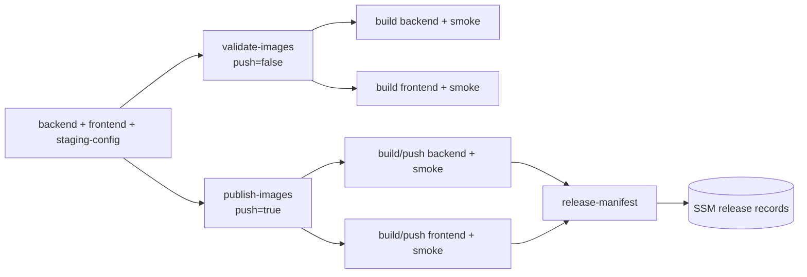

# CampusDesk — Phase 2: One Build Recipe

**Last reviewed:** 23 November 2026

**Status:** Implemented on `ci/build-recipe`; PR validation pending.

**Scope:** [.github/workflows/ci.yml](../.github/workflows/ci.yml), [.github/workflows/build-images.yml](../.github/workflows/build-images.yml), the frontend test job's local build environment, and the CI documentation.

**Related:** [CI/CD Hardening Plan](CI_CD_HARDENING_PLAN.md), [Phase 1 design](CI_CD_PHASE_1_DESIGN.md), [CI/CD implementation and operations guide](CI_CD_SESSION_2_HANDOFF.md), [CI-CD.md](../CI-CD.md).

## 1. Objective

The image build exists once and is used by both the PR validation path and the release publication path, so the validated build and the shipped build cannot diverge.

Today the backend and frontend images are built by four hand-maintained commands: `backend-image`/`frontend-image` for pull requests and `backend-publish`/`frontend-publish` for `development` pushes. The publish copies carry the same Dockerfile, labels, and frontend build arguments as the validation copies, but each must be changed independently. That already drifted once in `0a3c565`, when the Reverb key had to be added to both.

## 2. Non-goals

- Digest-pinning base images, provenance, and SBOM (Phase 3).
- Runtime Reverb configuration (Phase 4).
- Changing the release model: PR builds stay validation-only, and the release build still runs on the `development` push.

## 3. Target architecture

One reusable workflow, two caller jobs:



- [`.github/workflows/build-images.yml`](../.github/workflows/build-images.yml) is the single recipe, exposed with `workflow_call`.
- `ci.yml` calls it twice:
  - `validate-images` on pull requests (and manual non-push runs) with `push: false`;
  - `publish-images` on a `development` push with `push: true`.
- `release-manifest` changes from `needs: [backend-publish, frontend-publish]` to `needs: publish-images`, consuming that caller's digests.
- [deploy-staging.yml](../.github/workflows/deploy-staging.yml), the SSM document, and the host script are unchanged.

This diagram was rendered successfully with mermaid.ink and Kroki on 23 November 2026.

## 4. Reusable workflow interface

```yaml
on:
  workflow_call:
    inputs:
      push:
        required: true
        type: boolean
      image_tag:
        required: true
        type: string
    outputs:
      backend_digest:
        value: ${{ jobs.backend.outputs.digest }}
      frontend_digest:
        value: ${{ jobs.frontend.outputs.digest }}
```

Inside, two jobs (`backend`, `frontend`), each exposing `digest: ${{ steps.publish.outputs.digest }}`.

**Permissions:** the caller job controls them; the reusable workflow does not declare a narrower `permissions` block, so the push caller's `id-token: write` is available to the AWS steps. The PR caller grants only `contents: read`, and every AWS step is conditional on `inputs.push`, so no OIDC token is requested on the PR path.

**Contexts:** `vars.AWS_ROLE_ARN`, `vars.AWS_REGION`, `vars.AWS_ACCOUNT_ID`, `vars.ECR_BACKEND_REPOSITORY`, `vars.ECR_FRONTEND_REPOSITORY`, `vars.VITE_REVERB_APP_KEY`.

## 5. Per-image job flow

1. Check out the repository.
2. Set up Docker Buildx.
3. If `push`, configure AWS credentials (publisher role) and log in to ECR.
4. If `push`, check the immutable tag with `aws ecr describe-images`:
   - tag exists → `exists=true` and its digest;
   - `ImageNotFoundException` → `exists=false`;
   - any other error fails the job.
5. Compute the image reference:
   - push: `${registry}/${repository}:${image_tag}`;
   - PR: `campusdesk-backend:ci` / `campusdesk-frontend:ci`.
   Also compute the `created` timestamp for the label.
6. Build with `docker/build-push-action@v6` when `!push || exists == false`:
   - backend context/file `./campusdesk`;
   - frontend context/file `./Frontend`;
   - `load: true`, `push: false` — one build, tested before publication;
   - labels `org.opencontainers.image.revision`, `.source`, `.version`, `.created`;
   - frontend build args `VITE_API_URL=/api` and `VITE_REVERB_APP_KEY=${{ vars.VITE_REVERB_APP_KEY }}`.
7. Smoke-test the loaded image (same condition).
8. If `push`, publish:
   - `exists=true` → reuse the checked digest, no rebuild;
   - otherwise `docker push` the loaded image, then resolve the digest from ECR;
   - validate `^sha256:[0-9a-f]{64}$` and write it to the job output.

The PR path never contacts AWS or ECR and never requests OIDC.

## 6. Caller jobs and manifest job

```yaml
  validate-images:
    name: Validate images (PR)
    if: github.event_name != 'push'
    needs: [backend, frontend, staging-config]
    permissions:
      contents: read
    uses: ./.github/workflows/build-images.yml
    with:
      push: false
      image_tag: ${{ github.sha }}

  publish-images:
    name: Publish release images (development)
    if: github.event_name == 'push' && github.ref == 'refs/heads/development'
    needs: [backend, frontend, staging-config]
    permissions:
      contents: read
      id-token: write
    uses: ./.github/workflows/build-images.yml
    with:
      push: true
      image_tag: ${{ github.sha }}
```

`release-manifest` consumes `needs.publish-images.outputs.backend_digest` and `.frontend_digest`. Its own steps are unchanged: validate both digests, write `/campusdesk/releases/<sha>`, update `latest` only when the SHA is the current `development` tip, upload `release-manifest.json`, and write the summary.

**Fallback:** if reusable-workflow outputs do not surface as expected on the first push, `build-images.yml` can upload `image-digests.json` and `release-manifest` can download it with `actions/download-artifact` instead of using `needs` outputs. The native outputs are preferred.

## 7. Single definitions

- `VITE_API_URL` and `VITE_REVERB_APP_KEY` appear only in `build-images.yml`.
- The frontend quality job's own `npm run build` no longer sets `VITE_API_URL`; the image recipe is the only definition. The quality build remains a compile/type check and does not need the API URL.
- The four `docker build` commands are deleted; no `docker build` remains under `.github/`.

**Repository variable prerequisite:** create `VITE_REVERB_APP_KEY` (non-secret) and set it to `campusdesk-key` for now. Phase 4 removes the build-time key.

## 8. Smoke tests

Both images run as containers before publication.

Backend:

```bash
app_key='base64:AAAAAAAAAAAAAAAAAAAAAAAAAAAAAAAAAAAAAAAAAAA='
container_id="$(docker run -d --rm -e APP_KEY="$app_key" -p 127.0.0.1::80 "$IMAGE")"
trap 'docker rm -f "$container_id" >/dev/null 2>&1 || true' EXIT
port="$(docker port "$container_id" 80 | head -n1 | awk -F: '{print $NF}')"
```

Poll `http://127.0.0.1:${port}/up` for `200`. `/up` is Laravel's health route and does not need MySQL; the dummy key is a fixed non-secret value. Print `docker logs` on failure.

Frontend:

```bash
container_id="$(docker run -d --rm -p 127.0.0.1::80 "$IMAGE")"
```

Poll `http://127.0.0.1:${port}/` for `200`. Nginx serves static assets; no backend is needed.

On an existing immutable tag, the build and smoke test are skipped; that image was smoke-tested on its original build, and the manifest re-validates its digest.

## 9. Acceptance tests

- `grep -rn "docker build" .github/` returns no matches.
- `grep -rn "VITE_API_URL" .github/` returns exactly one definition.
- A PR run builds both images, passes both smoke tests, and makes no ECR call and no OIDC assumption.
- A `development` push builds and pushes both images with the same inputs as the PR path.
- `release-manifest` receives both digests and writes the same parameters as before; deployment still works.
- A rerun of the same push takes the existing-tag path, resolves the digest, and the manifest job succeeds without rebuilding.
- The smoke test fails the job when `/up` or `/` is not `200`.
- Both images carry `org.opencontainers.image.revision == github.sha`.

## 10. Rollout and test plan

1. Create the `VITE_REVERB_APP_KEY` repository variable.
2. Open the Phase 2 PR; the PR run exercises `validate-images` and the smoke tests without ECR.
3. Merge; the push run exercises `publish-images` and `release-manifest`. Verify `/campusdesk/releases/<sha>` and `/campusdesk/staging/latest`.
4. Deploy the merge SHA normally; verify the app and the deployment record.
5. Re-run the CI workflow for the same SHA; verify the existing-tag path, digest resolution, and manifest update without a rebuild.

## 11. Risks and decisions

| Risk / decision | Position |
| --- | --- |
| Reusable-workflow output exposure | Use `workflow_call.outputs`; validate on the first push; fall back to the `image-digests.json` artifact |
| Build-then-push | `build-push-action` with `load: true`, smoke test, then `docker push`; digest resolved from ECR |
| Permissions | Caller controls; PR `contents: read`; push adds `id-token: write`; AWS steps conditional |
| Backend smoke boot | `/up` with a dummy `APP_KEY`; no DB; logs on failure |
| Frontend test env | Remove its `VITE_API_URL` so the image recipe is the only definition |
| Existing tags | Preserve the skip/resolve behaviour; no duplicate pushes on reruns |
| Two jobs vs matrix | Two explicit jobs for clear per-image digests; a matrix would complicate outputs |
| Repository variable | `VITE_REVERB_APP_KEY` is non-secret and removed in Phase 4 |

## 12. PR

Phase 2 is one PR, `ci/build-recipe`:

- the reusable `build-images.yml`;
- the two caller jobs and the `release-manifest` `needs`/outputs change;
- the frontend test-job env removal;
- this design document and the plan/handoff updates.

The PR's own CI validates the PR path; the push path is validated on merge.
